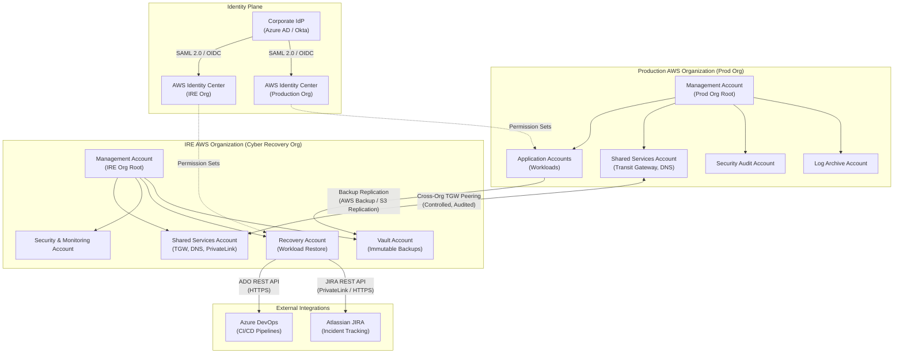
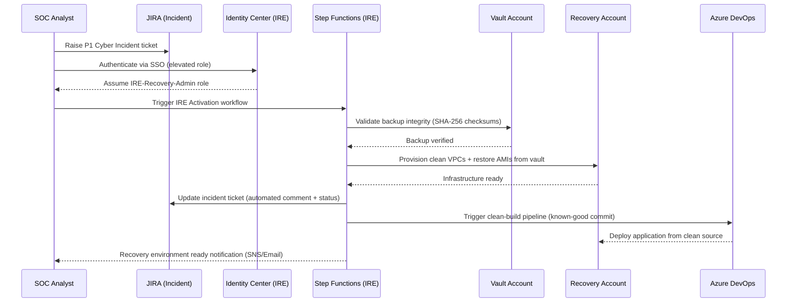
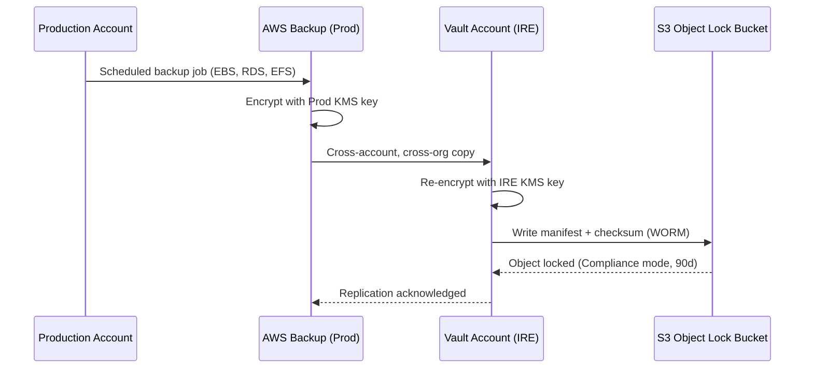
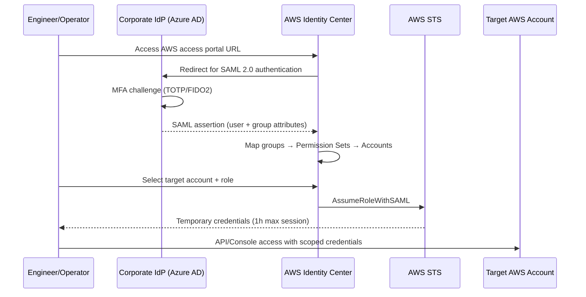
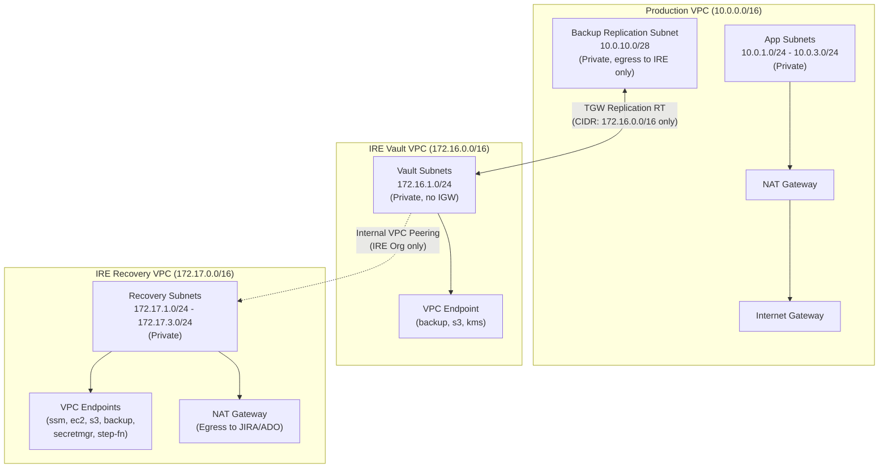

# Design Document: IRE (Isolated Recovery Environment) AWS Setup

## Overview

This document describes the architecture and implementation design for an Isolated Recovery Environment (IRE) on AWS, using a two-organization approach to achieve strong cyber recovery isolation. The Production AWS Organization runs all normal workloads, while a separate IRE AWS Organization provides a hardened, blast-radius-contained recovery environment that can be activated during a cyber incident.

The design covers cross-organization connectivity, user authentication via AWS Identity Center (SSO), external integrations with JIRA and Azure DevOps, network topology, and the security controls necessary to keep the IRE operationally independent yet accessible when needed.

The solution prioritises immutability, least-privilege access, and network segmentation so that a compromise of the Production Organization cannot propagate into the IRE Org. Recovery workflows are automated through Step Functions and pre-baked AMIs/snapshots stored in isolated vaults.

---

## Architecture

### High-Level: Two-Organization Overview



### Account Structure

| Organization | Account | Purpose |
|---|---|---|
| **Production Org** | Management | Org root, SCPs, billing consolidation |
| **Production Org** | Log Archive | Centralised CloudTrail, VPC Flow Logs, Config |
| **Production Org** | Security Audit | GuardDuty delegated admin, Security Hub, Macie |
| **Production Org** | Shared Services | Transit Gateway, Route 53 Resolver, DNS |
| **Production Org** | Application Accounts | Production workloads (N accounts) |
| **IRE Org** | Management | Org root, SCPs, billing for IRE |
| **IRE Org** | Vault | AWS Backup vaults (immutable lock), S3 Object Lock |
| **IRE Org** | Recovery | Workload restoration, forensic instances |
| **IRE Org** | Security & Monitoring | GuardDuty, Security Hub, CloudTrail for IRE |
| **IRE Org** | Shared Services | Transit Gateway, PrivateLink endpoints, DNS |

---

## Sequence Diagrams

### Cyber Recovery Activation Flow



### Normal Backup Replication Flow (Steady State)



### User Authentication Flow (AWS Identity Center)



---

## Components and Interfaces

### Component 1: AWS Organizations & SCPs

**Purpose**: Enforce guardrails at the organization level to prevent accidental or malicious changes that would compromise recovery isolation.

**Interface** (SCP Policy Attachment):
```json
{
  "OrganizationId": "o-xxxxxxxxxxxx",
  "PolicyType": "SERVICE_CONTROL_POLICY",
  "Targets": ["ou-xxxx-xxxxxxxx"],
  "PolicyDocument": { "Version": "2012-10-17", "Statement": [...] }
}
```

**Responsibilities**:
- Deny deletion of CloudTrail, Config, and GuardDuty in all accounts
- Deny disabling S3 Object Lock in the Vault account
- Deny VPC peering from IRE accounts to any non-approved CIDR
- Deny creation of IAM users (enforce SSO-only access)
- Enforce AWS Backup vault lock cannot be deleted for minimum 90 days
- Restrict which AWS regions can be used (reduce attack surface)

---

### Component 2: AWS Identity Center (SSO)

**Purpose**: Centralised human identity management for both organizations using a shared corporate IdP.

**Interface** (Permission Set):
```json
{
  "Name": "IRE-Recovery-Admin",
  "SessionDuration": "PT1H",
  "ManagedPolicies": ["arn:aws:iam::aws:policy/AdministratorAccess"],
  "InlinePolicy": {
    "Version": "2012-10-17",
    "Statement": [
      {
        "Sid": "DenyIREVaultDelete",
        "Effect": "Deny",
        "Action": ["backup:DeleteBackupVault", "s3:DeleteObject"],
        "Resource": "*"
      }
    ]
  },
  "AccountAssignments": [
    { "AccountId": "IRE_RECOVERY_ACCOUNT_ID", "PrincipalType": "GROUP", "PrincipalId": "IRE-Recovery-Team-Group-Id" }
  ]
}
```

**Responsibilities**:
- Single sign-on entry point for both Production Org and IRE Org
- SAML 2.0 / SCIM integration with corporate IdP (Azure AD/Okta)
- Just-in-time access provisioning via group membership
- Permission Sets define least-privilege role boundaries
- Separate Identity Center instances per organization (each org has its own)
- Break-glass accounts with hardware MFA for emergency access

---

### Component 3: Transit Gateway & Cross-Org Peering

**Purpose**: Controlled network path between Production and IRE, used only for backup replication and authorized recovery operations.

**Interface** (TGW Peering Attachment):
```json
{
  "PeerAccountId": "IRE_SHARED_SERVICES_ACCOUNT_ID",
  "PeerRegion": "ap-southeast-2",
  "PeerTransitGatewayId": "tgw-xxxxxxxxxxxxxxx",
  "Tags": [{ "Key": "Purpose", "Value": "IRE-Replication-Only" }]
}
```

**Responsibilities**:
- Accepts only specific source CIDRs (backup replication subnets)
- Route tables are locked — only backup subnets routed to IRE side
- No return route from IRE to Production workload subnets
- VPC Flow Logs enabled on all attachments
- TGW route tables use explicit deny for non-approved prefixes

---

### Component 4: AWS Backup & Vault

**Purpose**: Immutable, encrypted backup storage that survives a compromise of the Production environment.

**Interface** (Backup Plan):
```json
{
  "BackupPlanName": "IRE-Daily-Backup",
  "Rules": [
    {
      "RuleName": "DailyBackup",
      "ScheduleExpression": "cron(0 2 * * ? *)",
      "StartWindowMinutes": 60,
      "Lifecycle": { "DeleteAfterDays": 90 },
      "CopyActions": [
        {
          "DestinationBackupVaultArn": "arn:aws:backup:ap-southeast-2:IRE_VAULT_ACCOUNT:backup-vault:IRE-ImmutableVault",
          "Lifecycle": { "DeleteAfterDays": 365 }
        }
      ]
    }
  ]
}
```

**Responsibilities**:
- Backup EBS volumes, RDS clusters, EFS file systems, DynamoDB tables
- Cross-account and cross-organization copy to IRE Vault account
- Vault Lock in Compliance mode (minimum 90-day retention, cannot be deleted)
- Re-encryption with IRE-managed KMS key on copy
- Integrity validation via SHA-256 checksums stored in S3 (Object Lock)

---

### Component 5: JIRA Integration

**Purpose**: Automate incident tracking and recovery workflow status updates from within IRE.

**Interface** (JIRA REST API via PrivateLink):
```json
{
  "endpoint": "https://jira.company.internal/rest/api/3/issue",
  "auth": "Bearer ${secrets_manager_token}",
  "payload": {
    "fields": {
      "project": { "key": "CYB" },
      "summary": "IRE Activation - Incident ${INCIDENT_ID}",
      "issuetype": { "name": "Incident" },
      "priority": { "name": "Critical" },
      "customfield_10001": "${recovery_runbook_url}"
    }
  }
}
```

**Responsibilities**:
- Create/update incident tickets automatically from Step Functions
- Transition ticket workflow states (Investigating → Recovering → Resolved)
- Attach recovery artefacts (logs, screenshots) to ticket
- Connectivity via AWS PrivateLink (Atlassian Connect) or Site-to-Site VPN to corporate network
- Credentials stored in AWS Secrets Manager (IRE Recovery Account), rotated every 30 days

---

### Component 6: Azure DevOps Integration

**Purpose**: Trigger clean-build pipelines from known-good source code during recovery, ensuring no compromised artefacts are deployed.

**Interface** (Azure DevOps REST API):
```json
{
  "endpoint": "https://dev.azure.com/{org}/{project}/_apis/pipelines/{pipelineId}/runs",
  "auth": "Bearer ${secrets_manager_ado_pat}",
  "payload": {
    "resources": {
      "repositories": {
        "self": { "refName": "refs/heads/main", "version": "${CLEAN_COMMIT_SHA}" }
      }
    },
    "variables": {
      "TARGET_ENV": { "value": "IRE" },
      "DEPLOY_ACCOUNT": { "value": "${IRE_RECOVERY_ACCOUNT_ID}" }
    }
  }
}
```

**Responsibilities**:
- Receive webhook triggers from AWS Step Functions (outbound HTTPS)
- Build application from a pinned clean commit SHA (verified against code signing)
- Deploy build artefacts to IRE Recovery Account only
- Azure DevOps service connection uses IAM role via OIDC (no long-lived keys)
- Pipeline results posted back to Step Functions via callback token (SQS)

---

## Data Models

### IRE Activation Event

```json
{
  "eventType": "IRE_ACTIVATION",
  "incidentId": "string (UUID)",
  "activatedBy": "string (IAM principal ARN)",
  "activatedAt": "string (ISO 8601 timestamp)",
  "severity": "P1 | P2",
  "affectedAccounts": ["string (AWS account IDs)"],
  "backupPointInTime": "string (ISO 8601 timestamp)",
  "recoveryObjective": {
    "rto_hours": "number",
    "rpo_hours": "number"
  },
  "status": "INITIATED | VALIDATING | PROVISIONING | DEPLOYING | READY | FAILED",
  "jiraTicketId": "string",
  "recoveryAccountId": "string (AWS account ID)"
}
```

**Validation Rules**:
- `incidentId` must be globally unique (UUIDv4)
- `activatedBy` must match an allowed IAM principal pattern
- `backupPointInTime` must be within the last 90 days
- `rto_hours` must be ≤ 4 for P1 severity
- `status` transitions are strictly ordered (no backward transitions)

---

### Backup Record

```json
{
  "backupId": "string (ARN)",
  "sourceAccountId": "string",
  "resourceType": "EBS | RDS | EFS | DynamoDB",
  "resourceArn": "string",
  "completedAt": "string (ISO 8601)",
  "sizeBytes": "number",
  "encryptionKeyArn": "string (KMS ARN)",
  "checksum": {
    "algorithm": "SHA-256",
    "value": "string (hex)"
  },
  "vaultArn": "string",
  "retentionExpiresAt": "string (ISO 8601)",
  "locked": "boolean",
  "validatedAt": "string (ISO 8601 | null)"
}
```

**Validation Rules**:
- `checksum.value` verified before any restore operation begins
- `locked` must be `true` for all records in IRE Vault
- `retentionExpiresAt` must be ≥ 90 days from `completedAt`

---

### Permission Set Assignment

```json
{
  "principalType": "USER | GROUP",
  "principalId": "string (Identity Center entity ID)",
  "permissionSetArn": "string",
  "accountId": "string",
  "organization": "PROD | IRE",
  "grantedAt": "string (ISO 8601)",
  "expiresAt": "string (ISO 8601 | null)",
  "justification": "string",
  "approvedBy": "string"
}
```

**Validation Rules**:
- IRE `IRE-Recovery-Admin` assignments must have `expiresAt` ≤ 8h from `grantedAt`
- `justification` is mandatory for all IRE Recovery Account assignments
- All assignments logged to CloudTrail and JIRA incident ticket

---

## Algorithmic Pseudocode

### IRE Activation Workflow (Step Functions)

```pascal
ALGORITHM ActivateIRE(activationRequest)
INPUT:  activationRequest of type IREActivationEvent
OUTPUT: activationResult of type ActivationResult

BEGIN
  ASSERT activationRequest.incidentId IS NOT NULL
  ASSERT activationRequest.severity IN ["P1", "P2"]
  
  // Step 1: Validate caller authorization
  callerPrincipal ← GetCallerIdentity()
  IF callerPrincipal NOT IN AllowedIREActivators THEN
    RETURN Error("Unauthorized: Caller not permitted to activate IRE")
  END IF
  
  // Step 2: Create JIRA incident ticket
  jiraTicket ← JIRA.CreateIssue(
    project := "CYB",
    summary := "IRE Activation - " + activationRequest.incidentId,
    priority := activationRequest.severity
  )
  activationRequest.jiraTicketId ← jiraTicket.id
  
  // Step 3: Validate backup integrity
  FOR each resourceArn IN activationRequest.affectedAccounts.resources DO
    ASSERT ActivationStatus IS VALIDATING
    
    backup ← Vault.GetLatestBackup(resourceArn, activationRequest.backupPointInTime)
    
    IF backup IS NULL THEN
      JIRA.AddComment(jiraTicket.id, "No backup found for " + resourceArn)
      RETURN Error("No backup found for resource: " + resourceArn)
    END IF
    
    checksum ← Vault.ComputeChecksum(backup)
    IF checksum NOT EQUALS backup.storedChecksum THEN
      RETURN Error("Checksum mismatch for backup: " + backup.backupId)
    END IF
  END FOR
  
  // Step 4: Provision clean network infrastructure
  activationRequest.status ← PROVISIONING
  vpcConfig ← NetworkTemplate.Deploy(account := IRE_RECOVERY_ACCOUNT)
  JIRA.AddComment(jiraTicket.id, "Clean VPCs provisioned: " + vpcConfig.vpcIds)
  
  // Step 5: Restore workloads from validated backups
  FOR each backup IN validatedBackups DO
    ASSERT allPreviousRestoresSucceeded()
    
    restoreJob ← AWSBackup.StartRestoreJob(
      backupId := backup.backupId,
      targetAccountId := IRE_RECOVERY_ACCOUNT,
      targetVpcId := vpcConfig.primaryVpcId
    )
    WaitForCompletion(restoreJob, timeoutMinutes := 120)
  END FOR
  
  // Step 6: Trigger clean build pipeline in Azure DevOps
  activationRequest.status ← DEPLOYING
  adoPipelineRun ← AzureDevOps.TriggerPipeline(
    pipelineId := config.adoPipelineId,
    commitSha  := activationRequest.cleanCommitSha,
    targetEnv  := "IRE"
  )
  WaitForPipelineCallback(adoPipelineRun.callbackToken, timeoutMinutes := 60)
  
  // Step 7: Final validation and notification
  activationRequest.status ← READY
  JIRA.TransitionIssue(jiraTicket.id, transition := "Recovery Ready")
  SNS.Publish(topic := IRE_NOTIFICATIONS_TOPIC, message := "IRE is READY for operations")
  
  RETURN ActivationResult(status := SUCCESS, jiraTicketId := jiraTicket.id)
END
```

**Preconditions:**
- Caller has assumed `IRE-Recovery-Admin` permission set via Identity Center
- Vault account is reachable and Vault Lock is active
- Step Functions execution role has cross-account backup read access
- IRE Recovery Account has capacity for workload restoration

**Postconditions:**
- JIRA ticket created and updated at each workflow step
- All backup checksums verified before any restore begins
- Clean VPCs provisioned with no routes to Production networks
- Azure DevOps pipeline triggered with pinned clean commit SHA
- SNS notification sent to SOC team on completion

**Loop Invariants:**
- For each resource loop: All previously validated backups have verified checksums
- For each restore loop: All previously restored workloads are healthy before next restore begins

---

### Backup Integrity Validation Algorithm

```pascal
ALGORITHM ValidateBackupIntegrity(backupRecord)
INPUT:  backupRecord of type BackupRecord
OUTPUT: isValid of type Boolean

BEGIN
  // Check lock status — reject unlocked backups
  IF backupRecord.locked = FALSE THEN
    RETURN FALSE
  END IF
  
  // Check retention has not expired
  IF backupRecord.retentionExpiresAt < CurrentTimestamp() THEN
    RETURN FALSE
  END IF
  
  // Download manifest from S3 Object Lock store
  manifest ← S3.GetObject(
    bucket := IRE_MANIFEST_BUCKET,
    key    := backupRecord.backupId + "/manifest.json"
  )
  
  IF manifest IS NULL THEN
    RETURN FALSE
  END IF
  
  // Recompute checksum against manifest
  actualChecksum ← ComputeSHA256(backupRecord)
  
  IF actualChecksum NOT EQUALS manifest.checksum.value THEN
    CloudWatch.PutMetric(name := "BackupChecksumMismatch", value := 1)
    SNS.Publish(topic := SECURITY_ALERTS_TOPIC, message := "Checksum mismatch: " + backupRecord.backupId)
    RETURN FALSE
  END IF
  
  // Mark as validated
  backupRecord.validatedAt ← CurrentTimestamp()
  RETURN TRUE
END
```

**Preconditions:**
- `backupRecord` is non-null with all required fields populated
- S3 manifest bucket is accessible from IRE Recovery account
- CloudWatch and SNS permissions are available

**Postconditions:**
- Returns `TRUE` only if backup is locked, within retention, and checksum matches
- On mismatch: CloudWatch metric emitted, SNS alert published
- `validatedAt` updated on successful validation

---

### Cross-Org Network Connectivity Algorithm

```pascal
ALGORITHM EstablishCrossOrgPath(sourceAccount, targetVaultSubnet)
INPUT:  sourceAccount of type AWSAccount (Production)
        targetVaultSubnet of type SubnetCIDR (IRE Vault)
OUTPUT: routeStatus of type ConnectivityResult

BEGIN
  // Step 1: Verify TGW peering attachment is active
  peeringAttachment ← TGW.DescribePeeringAttachment(
    localTgwId  := PROD_TGW_ID,
    peerTgwId   := IRE_TGW_ID
  )
  
  IF peeringAttachment.state NOT EQUALS "available" THEN
    RETURN ConnectivityResult(status := FAILED, reason := "TGW peering not active")
  END IF
  
  // Step 2: Validate route table allows only backup subnet CIDRs
  routeTable ← TGW.GetRouteTable(id := PROD_TGW_REPLICATION_RT)
  
  FOR each route IN routeTable.routes DO
    IF route.destination NOT IN APPROVED_BACKUP_CIDRS THEN
      RETURN ConnectivityResult(status := FAILED, reason := "Unapproved route detected: " + route.destination)
    END IF
  END FOR
  
  // Step 3: Verify Security Group allows outbound to Vault only
  sg ← EC2.DescribeSecurityGroup(id := BACKUP_SG_ID, account := sourceAccount)
  
  IF sg.outboundRules NOT CONTAINS (port := 443, destination := targetVaultSubnet) THEN
    RETURN ConnectivityResult(status := FAILED, reason := "Security group missing required outbound rule")
  END IF
  
  // Step 4: Confirm VPC Flow Logs are active
  flowLogs ← EC2.DescribeFlowLogs(vpcId := sourceAccount.backupVpcId)
  
  IF flowLogs.status NOT EQUALS "ACTIVE" THEN
    RETURN ConnectivityResult(status := FAILED, reason := "VPC Flow Logs not active")
  END IF
  
  RETURN ConnectivityResult(status := SUCCESS, path := peeringAttachment.attachmentId)
END
```

---

## Network Topology

### VPC and Subnet Design



### Transit Gateway Route Tables

| Route Table | Attached VPCs | Routes | Purpose |
|---|---|---|---|
| `prod-tgw-replication-rt` | Prod Backup VPC | `172.16.0.0/16 → IRE TGW Peering` | Backup replication path |
| `ire-tgw-vault-rt` | IRE Vault VPC | `10.0.10.0/28 → Prod TGW Peering` | Accept replication from Prod |
| `ire-tgw-recovery-rt` | IRE Recovery VPC | `172.16.0.0/16 → IRE Vault VPC` | Recovery reads from Vault |

**Explicit denies**: No route from IRE Recovery VPC to any Production CIDR (10.0.0.0/8).

---

## Key Functions with Formal Specifications

### Function: ValidateIREReadiness()

```pascal
FUNCTION ValidateIREReadiness() RETURNS ReadinessReport
```

**Preconditions:**
- Called from IRE Security & Monitoring account
- CloudWatch metrics available for all IRE accounts

**Postconditions:**
- Returns report with pass/fail for each check
- If any critical check fails, SNS alert is raised
- Report written to S3 for audit trail

**Checks Performed:**
1. Vault Lock status = COMPLIANCE_MODE
2. All VPC Flow Logs = ACTIVE
3. GuardDuty = ENABLED across all IRE accounts
4. No IAM users exist in any IRE account (SSO-only)
5. SCPs are attached and not modified in last 24h
6. Backup replication lag < 24h for all protected resources

---

### Function: GrantTemporaryIREAccess()

```pascal
FUNCTION GrantTemporaryIREAccess(principal, justification, durationHours)
RETURNS AccessGrant
```

**Preconditions:**
- `principal` is a valid Identity Center group or user
- `durationHours` ≤ 8
- `justification` is non-empty and references a valid JIRA ticket

**Postconditions:**
- Permission Set assignment created with `expiresAt = now() + durationHours`
- JIRA ticket updated with access grant details
- CloudTrail event emitted
- Slack/SNS notification sent to security team

---

## Error Handling

### Scenario 1: Backup Checksum Mismatch

**Condition**: Stored SHA-256 checksum does not match recomputed checksum during IRE activation.

**Response**:
- IRE activation workflow halted immediately
- CloudWatch alarm raised (`BackupIntegrityAlarm`)
- SNS notification to Security team and SOC
- JIRA ticket status updated to "Blocked - Backup Integrity Failure"

**Recovery**:
- Security team investigates backup integrity breach
- Attempt restore from next-oldest valid backup
- If all backups compromised, escalate to DR runbook

---

### Scenario 2: TGW Cross-Org Connectivity Failure

**Condition**: TGW peering attachment is not active or route tables have been modified.

**Response**:
- Backup replication health check fails (CloudWatch alarm)
- EventBridge rule triggers Lambda to attempt TGW attachment refresh
- Alert sent to Network Operations team

**Recovery**:
- Lambda re-applies correct route table configuration from Terraform state
- If persistent, escalate to AWS Support (Network specialist)

---

### Scenario 3: Identity Center SSO Failure During Incident

**Condition**: Corporate IdP (Azure AD) unavailable during a cyber incident, blocking SSO to IRE.

**Response**:
- Break-glass accounts activated (hardware MFA protected, stored in physical safe)
- Break-glass usage automatically triggers CloudWatch alarm and JIRA ticket
- All actions during break-glass period logged with enhanced verbosity

**Recovery**:
- IdP restored, break-glass accounts immediately de-activated
- Post-incident review of all break-glass actions

---

### Scenario 4: Azure DevOps Pipeline Failure During Recovery

**Condition**: ADO pipeline fails to build or deploy to IRE Recovery Account.

**Response**:
- Step Functions task catches error, marks deployment step as FAILED
- JIRA ticket updated with pipeline run URL and error logs
- SNS alert to DevOps team

**Recovery**:
- Manual re-trigger via Step Functions console (with approved justification)
- Fallback: deploy last known-good artefact from S3 artefact store in IRE

---

## Testing Strategy

### Unit Testing Approach

Test individual Lambda functions and Step Functions states in isolation:
- Backup validation logic (checksum matching, lock status checks)
- JIRA API client (mock JIRA responses, error handling)
- Azure DevOps API client (mock pipeline trigger and callback)
- Identity Center permission set assignment/revocation logic

Key test cases:
- Checksum mismatch returns `FALSE` and emits CloudWatch metric
- Expired retention returns `FALSE` without checksum computation
- JIRA API 401 triggers Secrets Manager rotation and retry once
- Step Functions catches ADO pipeline timeout and transitions to FAILED state

### Property-Based Testing Approach

**Property Test Library**: `hypothesis` (Python) or `fast-check` (TypeScript)

Properties to verify:
- **Idempotency**: Running `ValidateBackupIntegrity` twice on the same record always returns the same result
- **No-regression**: `GrantTemporaryIREAccess` with `durationHours > 8` always returns an error, for all valid principal inputs
- **Route isolation**: For all possible route table configurations, no path exists from IRE Recovery VPC to Production workload subnets
- **Status monotonicity**: IRE activation status transitions are strictly forward (no backward transitions for any sequence of events)

### Integration Testing Approach

- End-to-end activation test in a dedicated test IRE account (non-production)
- JIRA sandbox used for integration tests
- Azure DevOps non-production pipeline for deployment verification
- Quarterly game-day exercises to validate the full recovery workflow under simulated conditions

---

## Security Considerations

### Blast Radius Containment

- IRE Org has no trust relationship with Production Org (separate root accounts)
- SCPs in IRE Org prevent any account from accepting peering from non-approved CIDRs
- IAM Resource Control Policies (RCPs) restrict S3 bucket access to IRE accounts only
- KMS keys in IRE are non-exportable and cannot be shared with Production accounts

### Data Protection

- All backups encrypted at rest with IRE-managed KMS keys (Customer Managed Keys)
- All cross-org traffic encrypted in transit (TLS 1.2+, VPN if required)
- S3 buckets in IRE have: bucket policies restricting access, no public ACLs, Object Lock enabled
- Vault Lock in Compliance mode prevents even root from deleting backups before retention expires

### Detection & Response

- GuardDuty enabled in all IRE accounts with threat intel feeds
- Security Hub aggregating findings from GuardDuty, Config, Inspector, Macie
- CloudTrail with log integrity validation (SHA-256 digest files)
- Config Rules enforcing: no IAM users, required tags, no open security groups, VPC Flow Logs active
- EventBridge → Lambda auto-remediation for common misconfigurations

### Privileged Access Management

- No long-lived IAM access keys anywhere in the IRE Org
- All human access via Identity Center (SAML) with max 1-hour session
- IRE Recovery Admin role requires time-limited assignment with JIRA ticket reference
- AWS Systems Manager Session Manager for EC2 access (no SSH key pairs)
- Privileged actions (Vault deletion attempts, SCP changes) trigger immediate SNS alerts

---

## Performance Considerations

- **RTO Target**: ≤ 4 hours for P1 incidents (full IRE activation and workload restoration)
- **RPO Target**: ≤ 24 hours (daily backup cycle, near-real-time replication for Tier-1 workloads)
- **Backup Replication Throughput**: Up to 10 Gbps via TGW (burst), 1 Gbps sustained
- **Step Functions concurrency**: Parallel restore jobs for independent workloads (fan-out up to 40 concurrent executions)
- **Pre-warmed AMIs**: Golden AMIs for common OS/runtime configurations stored in IRE Vault, reducing provisioning time by ~60%
- **Aurora Snapshot Restore**: RDS Aurora clusters restore to new cluster in ~10 minutes for databases ≤ 500 GB

---

## Dependencies

| Dependency | Purpose | Owner |
|---|---|---|
| AWS Organizations | Multi-account management and SCPs | Cloud Platform Team |
| AWS Identity Center | SSO and Permission Sets for both orgs | Identity & Access Team |
| AWS Backup | Backup plan execution and vault management | Platform/Operations |
| AWS Transit Gateway | Cross-org network connectivity | Network Team |
| AWS KMS (Customer Managed Keys) | Encryption for backups and secrets | Security Team |
| AWS Step Functions | IRE activation workflow orchestration | Platform Engineering |
| AWS Secrets Manager | JIRA and ADO credentials storage/rotation | Security Team |
| Atlassian JIRA | Incident tracking and workflow status | IT Service Management |
| Azure DevOps | CI/CD pipeline for clean builds | DevOps Team |
| Corporate IdP (Azure AD/Okta) | SAML 2.0 identity provider for SSO | Identity & Access Team |
| Terraform (IaC) | Infrastructure as Code for all resources | Platform Engineering |
| AWS Config + Security Hub | Compliance monitoring and alerting | Security Team |

---

## Correctness Properties

These properties define invariants that must hold at all times across the IRE system. They are suitable as property-based test targets and as compliance assertions in automated checks.

### Property 1: Vault Immutability

For all backup records `b` in the IRE Vault:
- `b.locked = TRUE` must always hold after initial write
- No process in any Production Org account can delete or modify `b`
- `b.retentionExpiresAt >= b.completedAt + 90 days` must always hold

### Property 2: Network Isolation

For all network paths `p` originating from any IRE Recovery VPC subnet:
- No path `p` reaches any Production workload subnet (10.0.1.0/24 - 10.0.3.0/24)
- The only permitted cross-org path is from Production Backup Subnet (10.0.10.0/28) to IRE Vault Subnet (172.16.1.0/24)
- All other cross-org traffic is denied at TGW route table level

### Property 3: Identity — No Long-Lived Credentials

For all IAM principals in both organizations:
- No IAM user with console or programmatic access exists (SSO-only enforced via SCP)
- No IAM access key with `age > 0 days` exists in any account
- All human sessions are bounded by `sessionDuration <= 1 hour`

### Property 4: IRE Activation Status Monotonicity

For any IRE activation workflow execution `e`:
- The status sequence must be strictly: `INITIATED -> VALIDATING -> PROVISIONING -> DEPLOYING -> READY`
- A transition to `FAILED` is terminal — no forward transitions from `FAILED` without a new execution
- No status can regress to an earlier state within the same execution

### Property 5: Backup Integrity Before Restore

For all restore operations `r` triggered during IRE activation:
- `r` can only proceed if `ValidateBackupIntegrity(r.backup) = TRUE`
- If any validation in a batch returns `FALSE`, the entire activation halts
- This property holds regardless of the number of resources being restored

### Property 6: Least-Privilege Access Grants

For all Permission Set assignments `a` targeting the IRE Recovery Account:
- `a.justification` is non-empty and contains a valid JIRA ticket reference
- `a.expiresAt` is set and `a.expiresAt <= a.grantedAt + 8 hours`
- Assignment creation emits a CloudTrail event with all required fields

### Property 7: Audit Trail Completeness

For all mutating API calls `c` across all IRE accounts:
- A corresponding CloudTrail event exists in the IRE Log Archive account
- Log file integrity digest for `c`'s time window is present and valid
- VPC Flow Log entry exists for all network-layer events associated with `c`
