# Design Document: AWS Cyber Recovery — Protected Recovery Environment (PRE)

## Overview

This document defines the technical architecture for an AWS Cyber Recovery Solution that transforms the existing Disaster Recovery (DR) VPC in `eu-central-1` into a Protected Recovery Environment (PRE). The PRE serves as a hardened, trust-verified staging environment where workloads — restored from Rubrik backups through the Isolated Recovery Environment (IRE) — are cleansed, validated, and approved before promotion back to production.

The design addresses three core security objectives: stopping attacker access to the DR VPC, establishing clean workload provenance, and preventing attacker re-entry. It achieves this through dedicated admin identities, independent KMS key hierarchies, hardened network controls, and a formal break-glass access mechanism — all while maintaining secure connectivity to the ISO Environment's foundational shared services.

The PRE is intentionally designed as an air-gapped, independently administered environment that shares no credential, key, or network trust chain with the potentially compromised production environment. This document covers both a High-Level Design (architecture, topology, trust boundaries, data flows) and a Low-Level Design (IAM policies, KMS key structure, VPC/subnet/NACL/SG configuration, TGW attachments, security tool integration, and the IRE→PRE→Prod promotion workflow).

---

## Part 1 — High-Level Design

---

## Architecture Overview

The recovery architecture consists of four distinct trust zones connected through controlled network paths:

1. **Production Zone** (`eu-west-1`) — potentially compromised; source of backed-up workloads via Rubrik
2. **ISO Environment** (separate AWS account) — trusted foundational shared services (AD, DNS, Terraform, GitHub, Azure DevOps, GCP connectivity)
3. **IRE (Isolated Recovery Environment)** — quarantined restore target; workloads arrive here from Rubrik and are scanned
4. **PRE (Protected Recovery Environment)** — the DR VPC in `eu-central-1`, re-purposed and hardened as the trusted staging environment

The PRE uses the existing DR VPC infrastructure but is treated as a new trust boundary. All prior network paths, IAM trust relationships, and credentials associated with Prod are severed. New independent identities, keys, and network controls are provisioned.

---

## System Architecture Diagram

```mermaid
graph TB
    subgraph PROD["Production Zone — eu-west-1 (Potentially Compromised)"]
        ProdVPC["Prod VPC\n10.0.0.0/16"]
        Rubrik["Rubrik Backup Agent"]
        ProdApp["Production Workloads"]
        ProdIAM["Prod IAM / Roles\n(Untrusted during incident)"]
    end

    subgraph ISO["ISO Environment — Separate AWS Account (Trusted)"]
        ISOTGW["Transit Gateway\n(ISO-side)"]
        MSAD["Microsoft AD\nAuthentication"]
        DNS["DNS Resolver"]
        CertMgmt["Certificate Authority"]
        GitHub["GitHub"]
        AzDevOps["Azure DevOps"]
        Terraform["Terraform Runner"]
        GCPConn["GCP Connectivity"]
        SecurityHub["Security Hub /\nLog Aggregation"]
    end

    subgraph IRE["IRE Account — Isolated Recovery Environment"]
        IREAccountBoundary["IAM Account Boundary"]
        IREVPC["IRE VPC\nQuarantine Zone"]
        RubrikRestore["Rubrik Restore Target"]
        Tanium_IRE["Tanium Agent"]
        CrowdStrike_IRE["CrowdStrike Sensor"]
        Qualys_IRE["Qualys Scanner"]
        IREScan["Workload\nCleansing & Scan"]
    end

    subgraph PRE["PRE — DR VPC eu-central-1 (Hardened Staging)"]
        PREVPC["PRE VPC\n10.1.0.0/16\n(re-purposed DR VPC)"]
        
        subgraph PRESubnets["PRE Network Segments"]
            MgmtSubnet["Management Subnet\n10.1.0.0/24"]
            WorkloadSubnet["Workload Subnet\n10.1.1.0/24"]
            ScanSubnet["Security Scan Subnet\n10.1.2.0/24"]
            EgressSubnet["Controlled Egress Subnet\n10.1.3.0/24"]
        end

        PRETGW["Transit Gateway Attachment\n(PRE-side)"]
        BreakGlass["Break-Glass\nAccess Mechanism"]
        PREKMS["PRE KMS Key Ring\n(Independent)"]
        PREIAM["PRE IAM Roles\n(Dedicated, Isolated)"]
        
        Tanium_PRE["Tanium Agent"]
        CrowdStrike_PRE["CrowdStrike Sensor"]
        Qualys_PRE["Qualys Scanner"]
        
        RecoveredWL["Recovered &\nValidated Workloads"]
        ApprovalGate["Approval Gate\n(Manual + Automated)"]
    end

    subgraph PROMOTION["Workload Promotion Path"]
        PromotedWL["Promoted Workloads\n→ Production"]
    end

    Rubrik -->|"Backup Data"| RubrikRestore
    IREScan -->|"Cleansed Workload\nAMI / Snapshot"| RecoveredWL
    
    IREVPC -.->|"Controlled Transfer\n(encrypted, one-way)"| PREVPC
    
    PREVPC <-->|"TGW — Controlled\nshared services only"| ISOTGW
    ISOTGW <-->|"Existing TGW"| ProdVPC

    MSAD -->|"PRE Admin Auth\n(dedicated OU)"| MgmtSubnet
    DNS --> PREVPC
    CertMgmt --> PREVPC
    Terraform -->|"IaC Deployment\nto PRE only"| PREVPC

    Tanium_IRE -.->|"Pre-approved\nscan access"| IREScan
    CrowdStrike_IRE -.->|"Pre-approved\nscan access"| IREScan
    Qualys_IRE -.->|"Pre-approved\nscan access"| IREScan

    Tanium_PRE -.->|"Continuous\nmonitoring"| RecoveredWL
    CrowdStrike_PRE -.->|"EDR coverage"| RecoveredWL
    Qualys_PRE -.->|"Vulnerability\nscanning"| RecoveredWL

    ApprovalGate -->|"Approved\nworkloads only"| PromotedWL

    ProdVPC -.->|"BLOCKED during\nincident"| PREVPC
```

---

## Trust Boundaries and Zone Definitions

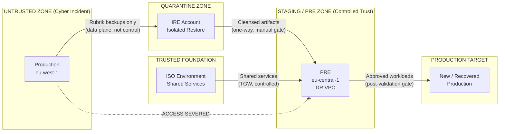

**Zone Trust Rules:**

| Zone | Trust Level | Communication Direction |
|------|------------|------------------------|
| Production (incident) | Untrusted | Outbound to Rubrik only |
| IRE | Quarantine | Receives from Prod via Rubrik; sends cleansed artifacts to PRE |
| ISO Environment | Trusted | Bidirectional with PRE (shared services only) |
| PRE | Controlled Trust | Receives from IRE; consumes ISO services; promotes to Prod |
| New Production | Target | Receives approved workloads from PRE |

---

## Data Flow: Cyber Recovery Sequence

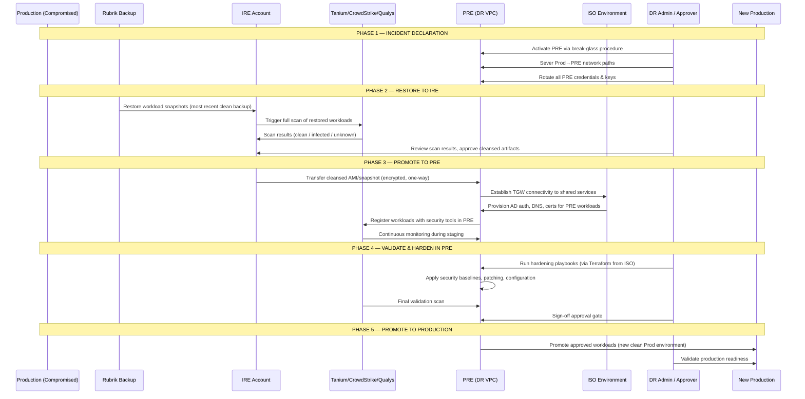

---

## Network Topology

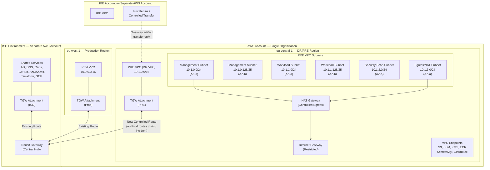

---

## Key Components Summary

| Component | Purpose | Location |
|-----------|---------|----------|
| PRE VPC (DR VPC) | Hardened staging environment | `eu-central-1` |
| PRE IAM Roles | Dedicated DR admin identities | AWS IAM (PRE account scope) |
| PRE KMS Key Ring | Independent encryption keys for PRE | AWS KMS `eu-central-1` |
| Transit Gateway | Controlled connectivity to ISO services | Shared TGW (ISO account) |
| Break-Glass Mechanism | Emergency out-of-band access | AWS SSM + dedicated IAM role |
| Rubrik | Backup and restore orchestration | On-premises / multi-cloud |
| IRE Account | Quarantine zone for initial restore | Separate AWS account |
| Tanium / CrowdStrike / Qualys | Security scanning and EDR | Pre-approved access to PRE |
| Microsoft AD (ISO) | Authentication for PRE admin identities | ISO Environment |
| Terraform (ISO) | IaC deployments into PRE | ISO Environment |
| VPC Flow Logs | Network traffic visibility | CloudWatch / S3 (PRE) |
| AWS CloudTrail | API audit trail | S3 (PRE, independent) |
| AWS Config | Configuration compliance monitoring | PRE region |

---

## Security Architecture Principles

1. **Zero Trust toward Production during incident** — All network paths from Prod VPC to PRE VPC are disabled via TGW route table modifications and NACLs. Prod IAM roles have no trust relationship with PRE IAM roles.

2. **Independent Key Management** — PRE KMS keys are created and administered by dedicated DR KMS administrators. No cross-account key access from Prod. Key policies explicitly deny Prod account principals.

3. **Dedicated Admin Identity Plane** — PRE administrators authenticate via a dedicated AD Organizational Unit (OU) in the ISO Microsoft AD. Federated IAM roles are scoped exclusively to PRE resources. No shared credentials with Prod admins.

4. **Defense in Depth Networking** — Traffic is controlled at four layers: TGW route tables, VPC NACLs, security groups, and host-level firewall (via Tanium/CrowdStrike policy enforcement). VPC Flow Logs provide full visibility.

5. **One-Way Artifact Promotion** — Workload artifacts flow from IRE → PRE via a controlled, encrypted, one-way transfer mechanism. There is no network path for reverse flow or lateral movement.

6. **Immutable Audit Trail** — CloudTrail logs, VPC Flow Logs, and security tool telemetry are written to an independent, write-once S3 bucket in the PRE environment with Object Lock enabled.

---

## Architecture

The PRE architecture layers four distinct trust zones — Production (untrusted during incident), IRE (quarantine restore), ISO Environment (trusted shared services), and PRE itself — connected through a central Transit Gateway with per-attachment isolated route tables. The PRE VPC (`eu-central-1`, `10.1.0.0/16`) re-purposes the existing DR VPC but severs all prior trust relationships with Production. Network segmentation is enforced at four independent layers: TGW route tables, VPC NACLs, security groups, and host-level policy via Tanium. Identity is managed through a dedicated AD Organizational Unit in the ISO environment, federated into AWS IAM Identity Center with MFA enforced. All encryption uses a PRE-exclusive KMS key ring administered by a role that explicitly cannot perform data operations, enforcing separation of duties. Terraform pipelines originate from the ISO environment and deploy into PRE, ensuring the PRE account cannot modify its own infrastructure-as-code state.

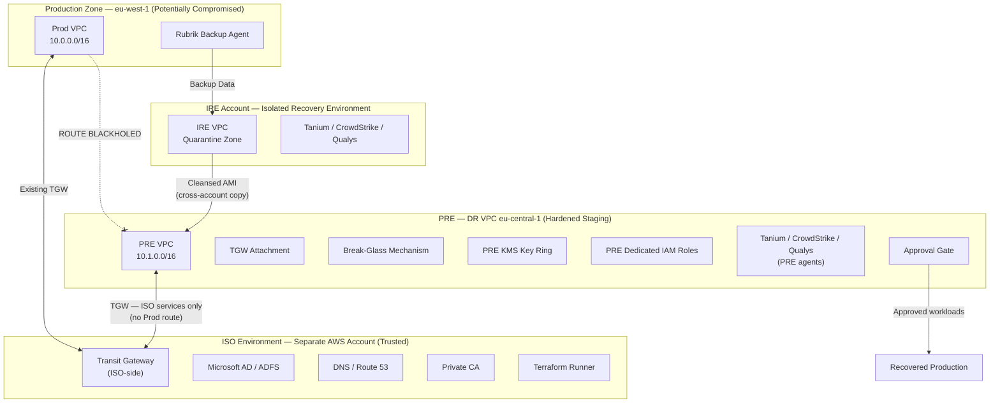

---

## Components and Interfaces

### Component 1: PRE VPC Network Layer

**Purpose**: Provides isolated, hardened network environment for recovered workloads with controlled ingress/egress and deep packet visibility.

**Interface**:

```pascal
COMPONENT PREVPCNetworkLayer
  PROVIDES:
    - Subnet isolation (management, workload, scan, egress)
    - NACL + Security Group dual-layer filtering
    - VPC Flow Logs (ALL traffic, CloudWatch + S3)
    - VPC Endpoints (SSM, KMS, S3, Secrets Manager, CloudTrail, Config)
    - Route 53 Resolver outbound (DNS forwarding to ISO)
    - NAT Gateway (controlled egress for security tool cloud callbacks)
  CONSUMES:
    - Transit Gateway attachment (connectivity to ISO)
    - AWS KMS (encryption for Flow Logs)
  CONSTRAINTS:
    - No default route to Production VPC (blackholed at TGW)
    - NACL explicit DENY rules for Production CIDR (10.0.0.0/16)
    - All inbound from internet blocked (no IGW inbound rules)
END COMPONENT
```

**Responsibilities**:
- Enforce network-level isolation between PRE and Production at NACL layer
- Route all AWS API calls through VPC Interface Endpoints (no internet traversal)
- Forward internal DNS queries to ISO AD DNS via Route 53 Resolver outbound endpoint
- Log all accepted and rejected traffic to CloudWatch Logs and S3 with Object Lock

### Component 2: PRE IAM Identity and Access Layer

**Purpose**: Provides dedicated, isolated identity and access management for the PRE environment, completely independent of Production IAM trust chains.

**Interface**:

```pascal
COMPONENT PREIAMLayer
  PROVIDES:
    - Federated IAM roles via SAML (ADFS from ISO AD)
    - Permission boundaries on all PRE roles (region-lock, deny Prod access)
    - Service Control Policies (deny Prod trust, deny KMS deletion, require MFA)
    - IAM role set: pre-dr-admin, pre-dr-network-admin, pre-dr-kms-admin,
                    pre-dr-readonly, pre-break-glass, pre-automation-deploy,
                    pre-workload-instance, pre-scan-tool-access
  CONSUMES:
    - ISO Microsoft AD (via TGW) for SAML federation
    - AWS IAM Identity Center for SSO integration
  CONSTRAINTS:
    - No cross-account trust to Production account ARNs
    - MFA required for all role assumptions
    - KMS admin role CANNOT perform data encryption/decryption operations
    - Break-glass role requires dual-person authorization
END COMPONENT
```

**Responsibilities**:
- Federate PRE admin identities from dedicated AD OU (not shared with Prod admins)
- Enforce permission boundaries on all roles to restrict actions to `eu-central-1` only
- Apply SCPs at AWS Organizations level to prevent privilege escalation and Prod trust
- Provide separation of duties between general DR admin and KMS key administration

### Component 3: PRE KMS Key Management Layer

**Purpose**: Manages an independent, PRE-exclusive KMS key hierarchy for all data encryption, ensuring no key material or key administrative access is shared with Production.

**Interface**:

```pascal
COMPONENT PREKMSLayer
  PROVIDES:
    - Key set: pre-ebs, pre-s3, pre-secrets, pre-cloudtrail, pre-rds, pre-workload
    - Key policies: deny Production account, deny key deletion/disable
    - Automatic annual key rotation for all keys
    - Cross-account grant for IRE→PRE artifact re-encryption (pre-workload key only)
  CONSUMES:
    - pre-dr-kms-admin IAM role (administration only, no data ops)
    - Workload roles (data usage via kms:Encrypt/Decrypt, via-service condition)
  CONSTRAINTS:
    - Key admin role cannot encrypt/decrypt data (separation of duties)
    - No key shared with or accessible from Production account
    - Key deletion requires AWS Organizations root; no individual can disable
END COMPONENT
```

**Responsibilities**:
- Provide dedicated encryption keys for every AWS service used in PRE (EBS, S3, Secrets Manager, CloudTrail, RDS)
- Enforce explicit DENY on Production account principals in every key policy
- Support one-time cross-account grant for IRE AMI re-encryption on arrival to PRE

### Component 4: Break-Glass Access Mechanism

**Purpose**: Provides an independent, out-of-band emergency access path that does not rely on the potentially compromised AD/SAML federation chain.

**Interface**:

```pascal
COMPONENT BreakGlassAccessMechanism
  PROVIDES:
    - Emergency assume-role for pre-break-glass IAM role
    - Dual-person authorization via Secrets Manager TOTP vault
    - Automatic alert on role assumption (CloudWatch → PagerDuty)
    - 1-hour maximum session duration
    - Automatic token rotation after every use
  CONSUMES:
    - AWS Secrets Manager (/pre/break-glass/activation-credentials)
    - SSM Parameter Store (/pre/break-glass/activation-request)
    - CloudWatch + SNS (alerting)
    - Lambda (activation orchestration)
  CONSTRAINTS:
    - MFA hardware token required (not TOTP app)
    - Minimum two authorized approvers must co-sign activation
    - All actions logged to immutable CloudTrail (S3 Object Lock)
    - Cannot be used to modify break-glass role itself (SCP deny)
END COMPONENT
```

**Responsibilities**:
- Provide access when AD/SAML federation is unavailable or compromised
- Enforce dual-person authorization to prevent insider threat abuse
- Generate immediate high-severity alerts to security team on every use
- Automatically rotate credentials after every activation to prevent replay

### Component 5: Security Tool Integration Layer

**Purpose**: Integrates Tanium, CrowdStrike, and Qualys into the PRE environment for continuous threat detection, vulnerability scanning, and compliance enforcement across all recovered workloads.

**Interface**:

```pascal
COMPONENT SecurityToolIntegrationLayer
  PROVIDES:
    - Tanium agent: continuous monitoring, compliance scanning, host firewall
    - CrowdStrike sensor: kernel-level EDR, real-time threat prevention
    - Qualys cloud agent + virtual scanner: vulnerability scanning, CIS benchmarks
    - Scan results: written to pre-scan-results-* S3 bucket
    - Integration with PRE promotion gate (all tools must report clean)
  CONSUMES:
    - NAT Gateway (CS and Qualys cloud callback — TCP 443)
    - TGW → ISO (Tanium server communication — TCP 8732)
    - SSM Parameter Store (agent registration tokens, server addresses)
    - Secrets Manager (activation keys — Qualys)
  CONSTRAINTS:
    - Same tool versions and policies as approved in IRE environment
    - Agents installed at instance launch (user-data or SSM Run Command)
    - Scan subnet (10.1.2.0/24) isolated from management and workload subnets
    - Tool communications via dedicated sg-pre-scan-tools security group
END COMPONENT
```

**Responsibilities**:
- Provide immediate threat coverage on workload arrival from IRE
- Feed scan results into the promotion gate automated checks
- Enforce host-level firewall and application control policies via Tanium
- Report EDR telemetry and vulnerability findings to respective consoles

### Component 6: Workload Promotion Pipeline

**Purpose**: Orchestrates the validated, gated workflow for promoting cleansed workloads through IRE → PRE → Production with automated checks and mandatory human approval gates.

**Interface**:

```pascal
COMPONENT WorkloadPromotionPipeline
  PROVIDES:
    - IRE→PRE artifact transfer (cross-account AMI copy + re-encryption)
    - Automated hardening playbooks (Terraform from ISO)
    - Automated compliance gate (Tanium Comply + AWS Config + Qualys)
    - Manual dual-approval gate (DR Lead + CISO)
    - PRE→Prod artifact promotion (new AMI + new Prod KMS key)
  CONSUMES:
    - IRE account (source AMI via cross-account snapshot share)
    - ISO Terraform runner (hardening IaC)
    - Security tool APIs (scan results)
    - AWS Backup (snapshot management)
  CONSTRAINTS:
    - Transfer is artifact-only (no live network path between IRE and PRE)
    - Re-encryption required on PRE arrival (alias/pre-workload key)
    - Re-encryption required on Prod promotion (new, clean Prod KMS key)
    - Promotion blocked if any critical/high security finding unresolved
END COMPONENT
```

**Responsibilities**:
- Execute one-way, encrypted artifact transfer from IRE to PRE with no network connectivity
- Apply and verify hardening baselines before workload enters PRE validation phase
- Enforce all-green automated checks as a prerequisite to manual approval
- Create new, re-encrypted AMIs for Production to break any key linkage to IRE

---

## Data Models

### Model 1: PRE Workload Recovery Record

```pascal
STRUCTURE WorkloadRecoveryRecord
  incident_id:          String          // Unique incident ticket reference
  workload_name:        String          // e.g., "api-service", "database-primary"
  source_backup_arn:    String          // Rubrik backup ARN or S3 snapshot reference
  ire_instance_id:      String          // EC2 instance ID in IRE account
  ire_ami_id:           String          // AMI created post-cleansing in IRE
  pre_ami_id:           String          // Re-encrypted copy in PRE account
  pre_instance_id:      String          // Running instance in PRE workload subnet
  restore_timestamp:    DateTime        // ISO 8601 (UTC)
  scan_results: ARRAY OF ScanResult
  hardening_status:     HardeningStatus
  promotion_status:     PromotionStatus
  approvals: ARRAY OF ApprovalRecord
  tags:                 MAP(String, String)
END STRUCTURE

STRUCTURE ScanResult
  tool:             Enum(TANIUM, CROWDSTRIKE, QUALYS)
  scan_type:        Enum(THREAT_DETECTION, VULNERABILITY, COMPLIANCE)
  timestamp:        DateTime
  status:           Enum(CLEAN, THREATS_FOUND, SCAN_ERROR, IN_PROGRESS)
  finding_count:    MAP(Severity, Integer)  // {CRITICAL: 0, HIGH: 0, MEDIUM: 2}
  report_s3_uri:    String
END STRUCTURE

STRUCTURE HardeningStatus
  playbook_version: String
  applied_at:       DateTime
  modules_applied:  ARRAY OF String
  patch_compliance: Float              // Percentage, must be >= 95.0
  config_compliance: Float            // AWS Config rules, must be 100.0
  status:           Enum(NOT_STARTED, IN_PROGRESS, PASSED, FAILED)
END STRUCTURE

STRUCTURE PromotionStatus
  current_phase:    Enum(IRE_RESTORE, IRE_SCAN, IRE_TO_PRE, PRE_HARDENING,
                         PRE_VALIDATION, AWAITING_APPROVAL, PROMOTING,
                         PROMOTED, FAILED)
  gate_passed:      Boolean
  blocked_reason:   Optional(String)
  promoted_ami_id:  Optional(String)
  promoted_at:      Optional(DateTime)
END STRUCTURE

STRUCTURE ApprovalRecord
  approver_arn:     String          // IAM ARN of approver
  approver_role:    Enum(DR_LEAD, CISO, DELEGATE)
  decision:         Enum(APPROVED, REJECTED)
  timestamp:        DateTime
  comments:         String
  incident_ticket:  String
END STRUCTURE
```

### Model 2: PRE Network Configuration State

```pascal
STRUCTURE PRENetworkConfig
  vpc_id:           String          // vpc-pre-eu-central-1
  vpc_cidr:         CIDR            // 10.1.0.0/16
  region:           String          // eu-central-1
  subnets:          ARRAY OF SubnetConfig
  route_tables:     ARRAY OF RouteTableConfig
  nacls:            ARRAY OF NACLConfig
  security_groups:  ARRAY OF SecurityGroupConfig
  tgw_attachment:   TGWAttachmentConfig
  vpc_endpoints:    ARRAY OF VPCEndpointConfig
  flow_logs:        FlowLogConfig
END STRUCTURE

STRUCTURE SubnetConfig
  name:             String          // e.g., "pre-mgmt-a"
  cidr:             CIDR
  az:               String          // eu-central-1a | eu-central-1b
  purpose:          Enum(MANAGEMENT, WORKLOAD, SCAN, EGRESS, TGW_ATTACH)
  route_table_id:   String
  nacl_id:          String
END STRUCTURE

STRUCTURE TGWAttachmentConfig
  tgw_id:           String
  attachment_id:    String
  route_table_id:   String          // Isolated PRE route table
  propagated_routes: ARRAY OF CIDR  // Only ISO CIDR; Prod CIDR explicitly absent
  blackhole_routes:  ARRAY OF CIDR  // 10.0.0.0/16 (Prod) — blackholed
END STRUCTURE
```

### Model 3: Break-Glass Activation Request

```pascal
STRUCTURE BreakGlassActivationRequest
  request_id:       UUID
  incident_id:      String          // Must reference open security ticket
  requestor_arn:    String          // IAM ARN of person requesting access
  approver_1_arn:   String          // First authorizing approver IAM ARN
  approver_2_arn:   String          // Second authorizing approver IAM ARN
  justification:    String          // Mandatory free-text justification
  totp_token:       String          // Time-limited token from Secrets Manager vault
  requested_at:     DateTime
  status:           Enum(PENDING, ACTIVATED, EXPIRED, REJECTED)
  session_expiry:   Optional(DateTime)  // Set to requested_at + 3600s on activation
END STRUCTURE
```

### Model 4: KMS Key Metadata

```pascal
STRUCTURE PREKMSKeyRecord
  alias:            String          // e.g., "alias/pre-ebs"
  key_id:           UUID            // AWS KMS Key ID
  purpose:          Enum(EBS, S3, SECRETS_MANAGER, CLOUDTRAIL, RDS, WORKLOAD_ARTIFACTS)
  rotation_enabled: Boolean         // Always true
  rotation_period:  Integer         // Days (365)
  cross_account:    Boolean         // Only true for pre-workload (IRE grant)
  deletion_window:  Integer         // Days (30, except pre-workload = 7)
  admin_role:       String          // Always "pre-dr-kms-admin"
  prod_access:      Enum(DENIED)    // Always DENIED via key policy
  created_at:       DateTime
  last_rotated:     Optional(DateTime)
END STRUCTURE
```

---

## Error Handling

### Error Scenario 1: Security Tool Reports Threat in PRE

**Condition**: CrowdStrike, Tanium, or Qualys detects an active threat or unresolved critical finding on a recovered workload instance in PRE.
**Response**: Automated promotion gate blocks progression. Instance is tagged `security-hold`. Alert sent to DR team and security operations. Instance is quarantined to an isolated security group (`sg-pre-quarantine`) with no outbound routes.
**Recovery**: DR team reviews finding, determines if it represents a real threat or false positive. If real threat: instance is terminated, IRE restore is re-evaluated with an earlier backup point. If false positive: DR team documents exception, re-runs scan, and manually unblocks the promotion gate with CISO approval.

### Error Scenario 2: Transit Gateway Route Contamination

**Condition**: An operator accidentally restores a TGW route entry pointing to the Production VPC attachment, breaking the network isolation of PRE.
**Response**: AWS Config rule `tgw-no-prod-routes` triggers immediately, flagging non-compliant state. EventBridge rule detects the route table modification and fires a P1 PagerDuty alert. VPC Flow Logs capture any traffic that may have traversed the route before detection.
**Recovery**: DR team immediately deletes the route and re-applies the blackhole entry for `10.0.0.0/16`. CloudTrail log review determines whether any traffic reached Production. If traffic exchanged, incident scope is escalated and PRE is re-validated before resuming recovery operations.

### Error Scenario 3: Break-Glass Role Assumed Without Proper Authorization

**Condition**: The `pre-break-glass` role is assumed without a valid dual-person activation record (e.g., token is stolen or the activation Lambda has a bug).
**Response**: CloudWatch alarm fires within 60 seconds of role assumption, sending P1 alert to CISO and security operations. EventBridge rule captures all API calls made under the session and feeds them to the security incident auto-responder Lambda.
**Recovery**: Security team immediately revokes the active session using `aws iam delete-service-specific-credential`. The break-glass token is rotated immediately. Full forensic review of all actions taken in the session is conducted from CloudTrail (immutable log). IAM Identity Center session is terminated for the user involved pending investigation.

### Error Scenario 4: KMS Key Deletion Attempt

**Condition**: An authorized or unauthorized principal attempts to schedule deletion of a PRE KMS key (e.g., alias/pre-ebs).
**Response**: SCP `PRE-DenyKMSKeyDeletion` blocks the API call with an explicit Deny. AWS Config rule `kms-key-rotation-enabled` runs continuously. CloudTrail logs the denied API call. CloudWatch alarm on `kms:ScheduleKeyDeletion` denied calls fires alert to security team.
**Recovery**: Security team reviews the CloudTrail event to determine if the attempt was accidental (operator error) or malicious (insider threat / compromised credential). Conduct IAM access review for the principal involved.

### Error Scenario 5: IRE→PRE AMI Transfer Integrity Failure

**Condition**: The AMI copied from IRE to PRE fails checksum validation, suggesting possible tampering or corruption in transit.
**Response**: Promotion pipeline Lambda flags the AMI as `integrity-failed` and blocks instance launch. The copied AMI is deregistered and its snapshot deleted. Alert sent to DR team.
**Recovery**: Re-initiate the cross-account AMI copy from the IRE source. If the IRE AMI itself fails validation, re-evaluate the IRE restore process and potentially re-scan the workload from a fresh Rubrik backup point.

---

## Testing Strategy

### Unit Testing Approach

Each Terraform module for PRE infrastructure is tested individually using `terraform validate` and `terraform plan` in a sandbox environment. IAM policy documents are validated using the AWS IAM Policy Simulator before deployment. KMS key policies are tested with `aws kms simulate-principal-policy` to verify that Production account principals are correctly denied and PRE roles are correctly permitted.

### Property-Based Testing Approach

**Property Test Library**: pytest-hypothesis (Python) for infrastructure property tests executed via the Terraform runner in ISO.

Key properties verified:

- **Network Isolation Property**: For all NACL rule sets in PRE, there must exist no rule that permits traffic from `10.0.0.0/16` (Production CIDR) to any PRE subnet. This is tested by enumerating all NACL entries via boto3 and asserting the invariant holds after every Terraform apply.
- **KMS Deny Property**: For all KMS key policies in PRE, every key must contain a DENY statement covering all actions for any principal matching the Production account ARN pattern. Tested by parsing key policies and asserting presence of the deny statement.
- **IAM Boundary Property**: For all IAM roles in PRE, the permission boundary must reference `PREPermissionBoundary`. Roles without a boundary trigger an AWS Config custom rule failure.
- **Break-Glass Idempotency**: Initiating a break-glass activation with the same token twice must result in the second request being rejected (token TTL expired). Tested via Lambda unit tests with mocked Secrets Manager.

### Integration Testing Approach

End-to-end recovery drills are conducted quarterly in a non-production copy of the PRE environment:

1. **Full Recovery Drill**: Simulate a cyber incident, restore a test workload from Rubrik into the IRE test environment, run all security tool scans, transfer the cleansed AMI to PRE test, apply hardening playbooks, pass through the promotion gate, and deploy to a test Production account. Measure RTO against target.
2. **Network Isolation Test**: After PRE activation, attempt to reach Production VPC from PRE workload subnet (expected: connection refused at TGW blackhole). Document results.
3. **Break-Glass Test**: Conduct scheduled break-glass activation drill annually. Verify all alerts fire, session expires correctly, and token rotates post-use.
4. **Security Tool Coverage Test**: Deploy a known-safe test indicator of compromise (EICAR test file) to a PRE test instance. Verify CrowdStrike detects and alerts within expected SLA.

---

## Correctness Properties

*A property is a characteristic or behavior that should hold true across all valid executions of a system — essentially, a formal statement about what the system should do. Properties serve as the bridge between human-readable specifications and machine-verifiable correctness guarantees.*

The following universal properties must hold true across the entire PRE architecture for correct operation of the cyber recovery solution:

### Property 1: Network Isolation Invariant

*For any* NACL rule set and TGW route table configuration in the PRE environment, there must be no ALLOW rule permitting traffic from `10.0.0.0/16` (Production CIDR) to any PRE subnet in either direction, and the TGW route for `10.0.0.0/16` must be blackholed.

**Validates: Requirements 1.1, 1.2, 1.3, 1.4**

---

### Property 2: IAM Role MFA Requirement

*For any* IAM role in the PRE account that is assumed by a human principal (all roles except `pre-automation-deploy` and `pre-workload-instance`), the AssumeRolePolicyDocument must contain a Condition requiring `aws:MultiFactorAuthPresent = true`. Simulating `sts:AssumeRoleWithSAML` without MFA context must return an explicit Deny.

**Validates: Requirements 3.2**

---

### Property 3: Permission Boundary Coverage

*For any* human-assumed IAM role in the PRE account, the `PermissionsBoundary` ARN must reference `PREPermissionBoundary`. Roles without this boundary are non-compliant. Additionally, for any privilege-escalation IAM action attempted by any role other than `pre-dr-admin`, policy simulation must return Deny.

**Validates: Requirements 3.3, 3.7**

---

### Property 4: Cross-Account Trust Isolation

*For any* IAM role in the PRE account, simulating `sts:AssumeRole` targeting any ARN in the Production account must return Deny. For any IAM role trust policy in the PRE account, there must be no Principal matching `arn:aws:iam::<PROD_ACCOUNT_ID>:*`. Both the permission boundary and the `PRE-DenyProdAccountTrust` SCP must independently enforce this.

**Validates: Requirements 3.4, 3.5**

---

### Property 5: MFA Required for Sensitive API Actions

*For any* call to `kms:PutKeyPolicy`, `kms:ScheduleKeyDeletion`, `kms:DisableKey`, `kms:DeleteAlias`, `iam:AttachRolePolicy`, `iam:PutRolePolicy`, `iam:DeleteRole`, or `iam:CreateRole`, if the request context does not carry `aws:MultiFactorAuthPresent = true`, the SCP `PRE-RequireMFAForSensitiveActions` must deny the call.

**Validates: Requirements 3.6**

---

### Property 6: KMS Key Rotation Enabled

*For any* KMS key in the PRE account with an `alias/pre-*` prefix, automatic key rotation must be enabled. Enumerating all PRE KMS keys and calling `GetKeyRotationStatus` must return `KeyRotationEnabled = true` for every key.

**Validates: Requirements 4.2**

---

### Property 7: KMS Admin Cannot Perform Data Operations

*For any* KMS data operation (`kms:Encrypt`, `kms:Decrypt`, `kms:ReEncrypt*`, `kms:GenerateDataKey*`, `kms:GenerateDataKeyWithoutPlaintext`) simulated with the `pre-dr-kms-admin` role as the principal against any PRE KMS key, the result must be an explicit Deny from the `PREKMSAdminPolicy`.

**Validates: Requirements 4.3**

---

### Property 8: KMS Key Policies Deny Production Account

*For any* KMS key in the PRE account with an `alias/pre-*` prefix, the key policy must contain at least one statement where `Effect = Deny`, `Action = kms:*`, and `Principal` matches `arn:aws:iam::<PROD_ACCOUNT_ID>:*`. Parsing the JSON key policy and asserting the presence of this statement must succeed for all PRE keys.

**Validates: Requirements 4.4, 4.5**

---

### Property 9: Break-Glass Dual Authorization

*For any* break-glass activation request, if `approver_1_arn` equals `approver_2_arn`, the activation Lambda must reject the request. For any two distinct approver ARNs with a valid time-limited token, the activation must proceed. The gate is: distinct approvers are both necessary and (when combined with a valid token) sufficient.

**Validates: Requirements 5.2, 5.3**

---

### Property 10: Break-Glass Token Round-Trip Invalidation

*For any* break-glass activation token that has been successfully used to assume the `pre-break-glass` role, after session end the rotation Lambda must generate a new token such that re-submitting the original token value returns a rejection. The token is consumed on use and must not be reusable.

**Validates: Requirements 5.6, 5.7**

---

### Property 11: Break-Glass Role Self-Modification Denied

*For any* IAM action targeting the `pre-break-glass` role itself (`iam:UpdateRole`, `iam:DeleteRole`, `iam:DetachRolePolicy`, `iam:DeleteRolePolicy`, `iam:PutRolePolicy`) when the requesting principal is the `pre-break-glass` role, policy simulation must return Deny.

**Validates: Requirements 5.9, 3.8**

---

### Property 12: Security Tool Coverage on Instance Launch

*For any* EC2 instance launched in a `pre-workload-*` subnet, querying the Tanium, CrowdStrike, and Qualys APIs at 15 minutes after launch time must return all three agents in a registered/active state for that instance. Any instance missing coverage must trigger a CloudWatch alarm.

**Validates: Requirements 6.1, 6.2**

---

### Property 13: Scan Results Encryption and Destination Invariant

*For any* scan result object written by any security tool, the S3 object must reside in a bucket matching the `pre-scan-results-*` pattern and the SSE-KMS encryption key must be `alias/pre-s3`. An object written to any other bucket or using any other key must be treated as a misconfiguration.

**Validates: Requirements 6.4, 10.4**

---

### Property 14: Threat Detection Triggers Isolation

*For any* detection event raised by CrowdStrike, Tanium, or Qualys on any PRE workload instance, the incident response Lambda must move that instance to `sg-pre-quarantine`, apply the `security-hold=true` tag, and block progression in the Promotion_Pipeline. These three actions must all occur together — no partial response is acceptable.

**Validates: Requirements 6.6, 13.1**

---

### Property 15: AMI Re-Encryption Invariant on IRE-to-PRE Transfer

*For any* AMI copied from the IRE account into the PRE account via the Promotion_Pipeline, the resulting snapshot in PRE must have its KMS encryption key set to `alias/pre-workload`. Any AMI in the PRE account with a `RestoredFrom` tag pointing to an IRE AMI but encrypted with a different key must be rejected.

**Validates: Requirements 7.2**

---

### Property 16: AMI Integrity Gate on Arrival

*For any* AMI that arrives in the PRE account from IRE and fails checksum integrity validation, the Promotion_Pipeline must deregister the AMI and delete its associated EBS snapshot before any other pipeline action occurs. A failed integrity check must never result in an instance being launched.

**Validates: Requirements 7.3**

---

### Property 17: Snapshot Share Cleanup After Transfer

*For any* AMI transferred from IRE to PRE, after the pipeline's transfer step completes, the IRE source AMI's `createVolumePermission` list must not contain the PRE account ID. The cross-account share must be revoked within the same pipeline execution as the copy operation.

**Validates: Requirements 7.4**

---

### Property 18: Workload Instance Encryption and IMDSv2 Invariant

*For any* running EC2 instance in the `pre-workload-*` subnets, the root EBS volume encryption key must be `alias/pre-ebs` and the instance metadata options must have `HttpTokens = required` with `HttpPutResponseHopLimit = 1`. Instances not meeting both conditions must be flagged as non-compliant.

**Validates: Requirements 7.5, 8.3**

---

### Property 19: Patch Compliance Gate

*For any* workload instance undergoing the hardening pipeline, if the SSM Patch Manager compliance score is less than 95.0%, the pipeline must not advance to the next hardening module. The gate is a strict threshold: score ≥ 95.0% is necessary to proceed.

**Validates: Requirements 8.2**

---

### Property 20: Instance Profile Isolation After Hardening

*For any* PRE workload instance after the IAM hardening module has executed, the attached IAM instance profile must be exactly `pre-workload-instance` with no additional profiles. Any other instance profile must be detached before the pipeline advances.

**Validates: Requirements 8.4**

---

### Property 21: Compliance Scan Gate

*For any* compliance scan result in the hardening pipeline where the count of non-compliant critical AWS Config rules is greater than zero, the pipeline must halt and not proceed to the validation phase. Zero critical non-compliance is a necessary precondition for advancement.

**Validates: Requirements 8.5**

---

### Property 22: Terraform State Externality

*For any* PRE IAM role, simulating `s3:PutObject` against the ISO account's Terraform state S3 bucket must return Deny. No PRE-account principal may write to that bucket. The state bucket's account ID must be the ISO account, not the PRE account.

**Validates: Requirements 8.6, 11.6**

---

### Property 23: Promotion Gate All-Green Precondition

*For any* workload in the Promotion_Pipeline, the approval gate must only transition to `AWAITING_APPROVAL` state when all of the following are simultaneously true: Tanium Comply ≥ 95%, CrowdStrike zero active detections, Qualys zero Critical/High CVEs, AWS Config zero non-compliant rules, SSM Patch Manager Compliant, and IMDSv2 enforced. If any single check fails, the gate must remain closed.

**Validates: Requirements 9.1, 9.2**

---

### Property 24: Dual Approval Gate Requirement

*For any* workload promotion attempt, the Promotion_Pipeline must require the existence of exactly one ApprovalRecord with `approver_role = DR_LEAD` and `decision = APPROVED`, and exactly one ApprovalRecord with `approver_role = CISO` and `decision = APPROVED`, before executing the Production promotion step. Any approval set missing either role, or containing an approval from a role other than those two, must leave the gate in a pending state.

**Validates: Requirements 9.3, 9.4**

---

### Property 25: Re-Encryption on Production Promotion

*For any* workload promoted from PRE to Production, the Production AMI's KMS encryption key ID must differ from `alias/pre-workload`. The key used for the Production AMI must be a new key created for the recovered Production environment. Asserting `production_ami_key_id ≠ pre_workload_key_id` must hold for every promoted workload.

**Validates: Requirements 9.5**

---

### Property 26: Audit Log Encryption Invariant

*For any* object in the `pre-cloudtrail-logs-*` S3 buckets, the SSE-KMS encryption key must be `alias/pre-cloudtrail`. *For any* object in `pre-vpc-flow-logs-*` or `pre-scan-results-*` buckets, the SSE-KMS encryption key must be `alias/pre-s3`. Objects encrypted with any other key must be treated as a configuration violation.

**Validates: Requirements 10.6, 10.4**

---

### Property 27: TGW Route Config Rule Correctness

*For any* TGW route table associated with the PRE VPC attachment that contains a route with destination `10.0.0.0/16` targeting the Production VPC attachment (not a blackhole), the custom AWS Config rule `tgw-no-prod-routes` must evaluate the resource as `NON_COMPLIANT`. *For any* route table where `10.0.0.0/16` is absent or blackholed, the rule must evaluate as `COMPLIANT`.

**Validates: Requirements 1.6, 12.4**

---

### Property 28: WorkloadRecoveryRecord Completeness Invariant

*For any* WorkloadRecoveryRecord at or after the `PRE_HARDENING` phase, the fields `incident_id`, `workload_name`, `source_backup_arn`, `ire_ami_id`, `pre_ami_id`, `restore_timestamp`, and at least one ScanResult entry must be non-null and non-empty. *For any* record at the `PROMOTED` phase, `PromotionStatus.promoted_ami_id`, `PromotionStatus.promoted_at`, and two ApprovalRecords with distinct `approver_role` values must additionally be present.

**Validates: Requirements 7.6, 9.6, 14.1, 14.2, 14.3, 14.4, 14.5, 14.6**

---

## Part 2 — Low-Level Design

---

## IAM Architecture — Roles, Policies, and Permission Boundaries

### DR Admin Identity Model

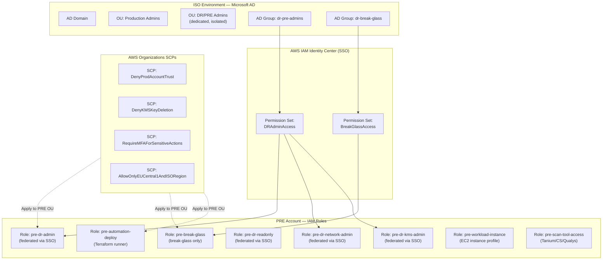

### IAM Role Definitions

**Role: `pre-dr-admin`**

```json
{
  "RoleName": "pre-dr-admin",
  "Description": "Primary DR admin role for PRE environment management. Federated from ISO AD via AWS IAM Identity Center.",
  "AssumeRolePolicyDocument": {
    "Version": "2012-10-17",
    "Statement": [
      {
        "Effect": "Allow",
        "Principal": {
          "Federated": "arn:aws:iam::<PRE_ACCOUNT_ID>:saml-provider/ISOADProvider"
        },
        "Action": "sts:AssumeRoleWithSAML",
        "Condition": {
          "StringEquals": {
            "SAML:aud": "https://signin.aws.amazon.com/saml"
          },
          "Bool": {
            "aws:MultiFactorAuthPresent": "true"
          }
        }
      }
    ]
  },
  "PermissionBoundary": "arn:aws:iam::<PRE_ACCOUNT_ID>:policy/PREPermissionBoundary",
  "ManagedPolicies": [
    "arn:aws:iam::<PRE_ACCOUNT_ID>:policy/PREAdminPolicy",
    "arn:aws:iam::aws:policy/ReadOnlyAccess"
  ],
  "Tags": {
    "Environment": "PRE",
    "ManagedBy": "terraform",
    "Owner": "dr-team",
    "CostCenter": "cyber-recovery"
  }
}
```

**Policy: `PREPermissionBoundary`**

```json
{
  "Version": "2012-10-17",
  "Statement": [
    {
      "Sid": "AllowPRERegionOnly",
      "Effect": "Allow",
      "Action": "*",
      "Resource": "*",
      "Condition": {
        "StringEquals": {
          "aws:RequestedRegion": ["eu-central-1"]
        }
      }
    },
    {
      "Sid": "DenyProdAccountAccess",
      "Effect": "Deny",
      "Action": "sts:AssumeRole",
      "Resource": "arn:aws:iam::<PROD_ACCOUNT_ID>:role/*"
    },
    {
      "Sid": "DenyKMSKeyDeletionAndDisable",
      "Effect": "Deny",
      "Action": [
        "kms:DisableKey",
        "kms:DeleteImportedKeyMaterial",
        "kms:ScheduleKeyDeletion"
      ],
      "Resource": "*"
    },
    {
      "Sid": "DenyIAMPrivilegeEscalation",
      "Effect": "Deny",
      "Action": [
        "iam:CreatePolicyVersion",
        "iam:SetDefaultPolicyVersion",
        "iam:AttachRolePolicy",
        "iam:PutRolePolicy",
        "iam:PassRole"
      ],
      "Resource": "*",
      "Condition": {
        "StringNotEquals": {
          "aws:PrincipalTag/Role": "pre-dr-admin"
        }
      }
    },
    {
      "Sid": "DenyModifyBreakGlassRole",
      "Effect": "Deny",
      "Action": [
        "iam:UpdateRole",
        "iam:DeleteRole",
        "iam:DetachRolePolicy",
        "iam:DeleteRolePolicy"
      ],
      "Resource": "arn:aws:iam::<PRE_ACCOUNT_ID>:role/pre-break-glass"
    }
  ]
}
```

**Policy: `PREAdminPolicy`** (inline — full PRE management within boundary)

```json
{
  "Version": "2012-10-17",
  "Statement": [
    {
      "Sid": "PREComputeManagement",
      "Effect": "Allow",
      "Action": [
        "ec2:*",
        "autoscaling:*",
        "elasticloadbalancing:*"
      ],
      "Resource": "*",
      "Condition": {
        "StringEquals": {
          "aws:RequestedRegion": "eu-central-1",
          "ec2:ResourceTag/Environment": "PRE"
        }
      }
    },
    {
      "Sid": "PREStorageManagement",
      "Effect": "Allow",
      "Action": [
        "s3:*",
        "ebs:*",
        "backup:*"
      ],
      "Resource": [
        "arn:aws:s3:::pre-*",
        "arn:aws:s3:::pre-*/*"
      ]
    },
    {
      "Sid": "PREKMSUsage",
      "Effect": "Allow",
      "Action": [
        "kms:Encrypt",
        "kms:Decrypt",
        "kms:ReEncrypt*",
        "kms:GenerateDataKey*",
        "kms:DescribeKey"
      ],
      "Resource": "arn:aws:kms:eu-central-1:<PRE_ACCOUNT_ID>:key/*",
      "Condition": {
        "StringEquals": {
          "kms:ResourceAliases": "alias/pre-*"
        }
      }
    },
    {
      "Sid": "PRENetworkReadOnly",
      "Effect": "Allow",
      "Action": [
        "ec2:Describe*",
        "vpc:Describe*"
      ],
      "Resource": "*"
    },
    {
      "Sid": "PRESSMAccess",
      "Effect": "Allow",
      "Action": [
        "ssm:*",
        "ssmmessages:*",
        "ec2messages:*"
      ],
      "Resource": "*",
      "Condition": {
        "StringEquals": {
          "aws:RequestedRegion": "eu-central-1"
        }
      }
    },
    {
      "Sid": "PRECloudWatchLogs",
      "Effect": "Allow",
      "Action": [
        "logs:*",
        "cloudwatch:*",
        "cloudtrail:LookupEvents",
        "cloudtrail:GetTrailStatus"
      ],
      "Resource": "*"
    }
  ]
}
```

**Role: `pre-dr-kms-admin`** (separate from general admin — KMS separation of duties)

```json
{
  "RoleName": "pre-dr-kms-admin",
  "Description": "Dedicated KMS administrator for PRE. Can manage KMS key policies and grants but cannot use keys for data operations. Strictly separate from general DR admin.",
  "ManagedPolicies": [
    "arn:aws:iam::<PRE_ACCOUNT_ID>:policy/PREKMSAdminPolicy"
  ]
}
```

```json
{
  "PolicyName": "PREKMSAdminPolicy",
  "Statement": [
    {
      "Sid": "KMSKeyAdministration",
      "Effect": "Allow",
      "Action": [
        "kms:Create*",
        "kms:Describe*",
        "kms:Enable*",
        "kms:List*",
        "kms:Put*",
        "kms:Update*",
        "kms:GetKeyPolicy",
        "kms:GetKeyRotationStatus",
        "kms:TagResource",
        "kms:UntagResource",
        "kms:EnableKeyRotation",
        "kms:DisableKeyRotation"
      ],
      "Resource": "arn:aws:kms:eu-central-1:<PRE_ACCOUNT_ID>:key/*"
    },
    {
      "Sid": "DenyKMSDataOperations",
      "Effect": "Deny",
      "Action": [
        "kms:Encrypt",
        "kms:Decrypt",
        "kms:ReEncrypt*",
        "kms:GenerateDataKey*"
      ],
      "Resource": "*"
    },
    {
      "Sid": "DenyKeyDeletion",
      "Effect": "Deny",
      "Action": [
        "kms:ScheduleKeyDeletion",
        "kms:DisableKey"
      ],
      "Resource": "*"
    }
  ]
}
```

**Role: `pre-break-glass`** (emergency access only)

```json
{
  "RoleName": "pre-break-glass",
  "Description": "Emergency break-glass role. Assumed via dedicated SSM parameter-protected mechanism. All usage triggers immediate CloudWatch alarms and PagerDuty alerts.",
  "AssumeRolePolicyDocument": {
    "Statement": [
      {
        "Effect": "Allow",
        "Principal": {
          "AWS": "arn:aws:iam::<PRE_ACCOUNT_ID>:role/pre-break-glass-activator"
        },
        "Action": "sts:AssumeRole",
        "Condition": {
          "Bool": {
            "aws:MultiFactorAuthPresent": "true"
          },
          "StringEquals": {
            "sts:TransitiveTagKeys": "BreakGlassActivation"
          }
        }
      }
    ]
  },
  "ManagedPolicies": [
    "arn:aws:iam::aws:policy/AdministratorAccess"
  ],
  "MaxSessionDuration": 3600,
  "Tags": {
    "CriticalRole": "true",
    "MonitoredAccess": "true"
  }
}
```

**Service Control Policies (SCPs)**

```json
{
  "PolicyName": "PRE-DenyProdAccountTrust",
  "Description": "Applied to PRE OU. Prevents any PRE role from trusting or assuming roles in the Production account.",
  "Statement": [
    {
      "Sid": "DenyProdAccountSTSTrust",
      "Effect": "Deny",
      "Action": "sts:AssumeRole",
      "Resource": "arn:aws:iam::<PROD_ACCOUNT_ID>:role/*"
    },
    {
      "Sid": "DenyProdPrincipalAccess",
      "Effect": "Deny",
      "Action": "*",
      "Resource": "*",
      "Condition": {
        "ArnLike": {
          "aws:PrincipalArn": "arn:aws:iam::<PROD_ACCOUNT_ID>:*"
        }
      }
    }
  ]
}
```

```json
{
  "PolicyName": "PRE-RequireMFAForSensitiveActions",
  "Statement": [
    {
      "Sid": "RequireMFAForKMSKeyAdmin",
      "Effect": "Deny",
      "Action": [
        "kms:DisableKey",
        "kms:ScheduleKeyDeletion",
        "kms:PutKeyPolicy",
        "kms:DeleteAlias"
      ],
      "Resource": "*",
      "Condition": {
        "BoolIfExists": {
          "aws:MultiFactorAuthPresent": "false"
        }
      }
    },
    {
      "Sid": "RequireMFAForIAMChanges",
      "Effect": "Deny",
      "Action": [
        "iam:AttachRolePolicy",
        "iam:PutRolePolicy",
        "iam:DeleteRole",
        "iam:CreateRole"
      ],
      "Resource": "*",
      "Condition": {
        "BoolIfExists": {
          "aws:MultiFactorAuthPresent": "false"
        }
      }
    }
  ]
}
```

---

## KMS Key Hierarchy

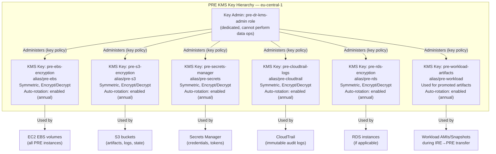

**KMS Key Policy Template (pre-ebs-encryption)**

```json
{
  "Version": "2012-10-17",
  "Id": "pre-ebs-encryption-key-policy",
  "Statement": [
    {
      "Sid": "EnableKeyAdministration",
      "Effect": "Allow",
      "Principal": {
        "AWS": [
          "arn:aws:iam::<PRE_ACCOUNT_ID>:role/pre-dr-kms-admin",
          "arn:aws:iam::<PRE_ACCOUNT_ID>:root"
        ]
      },
      "Action": [
        "kms:Create*",
        "kms:Describe*",
        "kms:Enable*",
        "kms:List*",
        "kms:Put*",
        "kms:Update*",
        "kms:GetKeyPolicy",
        "kms:EnableKeyRotation"
      ],
      "Resource": "*"
    },
    {
      "Sid": "AllowPREWorkloadUsage",
      "Effect": "Allow",
      "Principal": {
        "AWS": [
          "arn:aws:iam::<PRE_ACCOUNT_ID>:role/pre-dr-admin",
          "arn:aws:iam::<PRE_ACCOUNT_ID>:role/pre-workload-instance",
          "arn:aws:iam::<PRE_ACCOUNT_ID>:role/pre-automation-deploy"
        ]
      },
      "Action": [
        "kms:Encrypt",
        "kms:Decrypt",
        "kms:ReEncrypt*",
        "kms:GenerateDataKey*",
        "kms:DescribeKey",
        "kms:CreateGrant"
      ],
      "Resource": "*",
      "Condition": {
        "StringEquals": {
          "kms:ViaService": [
            "ec2.eu-central-1.amazonaws.com",
            "ebs.eu-central-1.amazonaws.com"
          ]
        }
      }
    },
    {
      "Sid": "DenyProductionAccountAccess",
      "Effect": "Deny",
      "Principal": "*",
      "Action": "kms:*",
      "Resource": "*",
      "Condition": {
        "ArnLike": {
          "aws:PrincipalArn": [
            "arn:aws:iam::<PROD_ACCOUNT_ID>:*"
          ]
        }
      }
    },
    {
      "Sid": "DenyKeyDeletionByAll",
      "Effect": "Deny",
      "Principal": "*",
      "Action": [
        "kms:ScheduleKeyDeletion",
        "kms:DisableKey"
      ],
      "Resource": "*",
      "Condition": {
        "StringNotEquals": {
          "aws:PrincipalArn": "arn:aws:iam::<PRE_ACCOUNT_ID>:root"
        }
      }
    }
  ]
}
```

**Key Rotation and Lifecycle Policy:**

| Key Alias | Rotation | Deletion Window | Cross-Account | Notes |
|-----------|----------|----------------|---------------|-------|
| `alias/pre-ebs` | Annual (auto) | 30 days | Denied | EC2 EBS volumes only |
| `alias/pre-s3` | Annual (auto) | 30 days | Denied | S3 SSE-KMS |
| `alias/pre-secrets` | Annual (auto) | 30 days | Denied | Secrets Manager |
| `alias/pre-cloudtrail` | Annual (auto) | 30 days | Denied | Immutable log encryption |
| `alias/pre-rds` | Annual (auto) | 30 days | Denied | RDS/Aurora encryption |
| `alias/pre-workload` | On each recovery cycle | 7 days post-promotion | IRE→PRE only (grant) | Re-encrypt on PRE arrival |

---

## Network Configuration — VPC, Subnets, NACLs, Security Groups, TGW

### VPC Configuration

```
VPC ID:          vpc-pre-eu-central-1
CIDR:            10.1.0.0/16
Region:          eu-central-1
DNS Hostnames:   Enabled
DNS Resolution:  Enabled (via ISO AD DNS via TGW)
Tenancy:         Default (can be Dedicated for high-sensitivity workloads)
VPC Flow Logs:   Enabled → CloudWatch Logs + S3 (pre-vpc-flow-logs bucket)
                 Format: ALL (accepted + rejected)
                 Traffic type: ALL
```

### Subnet Design

| Subnet Name | CIDR | AZ | Purpose | Route Table |
|-------------|------|----|---------|-------------|
| `pre-mgmt-a` | `10.1.0.0/25` | eu-central-1a | Bastion hosts, SSM endpoints, DR admin access | `rt-pre-mgmt` |
| `pre-mgmt-b` | `10.1.0.128/25` | eu-central-1b | HA management subnet | `rt-pre-mgmt` |
| `pre-workload-a` | `10.1.1.0/25` | eu-central-1a | Recovered workload instances | `rt-pre-workload` |
| `pre-workload-b` | `10.1.1.128/25` | eu-central-1b | Recovered workload instances (HA) | `rt-pre-workload` |
| `pre-scan-a` | `10.1.2.0/25` | eu-central-1a | Security tool agents (Tanium, CrowdStrike, Qualys) | `rt-pre-scan` |
| `pre-scan-b` | `10.1.2.128/25` | eu-central-1b | Security tool agents (HA) | `rt-pre-scan` |
| `pre-egress-a` | `10.1.3.0/25` | eu-central-1a | NAT Gateway, controlled internet egress | `rt-pre-egress` |
| `pre-tgw-attach` | `10.1.4.0/28` | eu-central-1a | TGW attachment ENIs (must be /28 minimum) | `rt-pre-tgw` |

### Route Tables

**Management Route Table (`rt-pre-mgmt`)**

```
Destination       Target              Purpose
10.1.0.0/16       local               VPC-local routing
10.2.0.0/16       tgw-attach          ISO Environment CIDR via TGW
0.0.0.0/0         (no route)          No default internet route — SSM VPC endpoints used
```

**Workload Route Table (`rt-pre-workload`)**

```
Destination       Target              Purpose
10.1.0.0/16       local               VPC-local routing
10.2.0.0/16       tgw-attach          ISO shared services (AD auth, DNS, certs)
0.0.0.0/0         nat-gw-pre-a        Controlled egress via NAT (Qualys cloud updates only)
```

**TGW Route Table (PRE attachment)**

```
Destination       Target              Purpose
10.1.0.0/16       pre-vpc-attachment  Routes into PRE VPC
(NO route to       --                 Prod VPC route REMOVED during incident)
 10.0.0.0/16)
10.2.0.0/16       iso-attachment      Routes to ISO shared services
```

### Network ACLs

**NACL: `nacl-pre-mgmt`** (Management Subnet)

| Rule | Direction | Protocol | Port Range | Source/Dest | Action | Reason |
|------|-----------|----------|-----------|-------------|--------|--------|
| 100 | Inbound | TCP | 443 | `10.2.0.0/16` (ISO) | ALLOW | HTTPS from ISO shared services |
| 110 | Inbound | TCP | 389,636 | `10.2.0.0/16` (ISO) | ALLOW | LDAP/LDAPS from ISO AD |
| 120 | Inbound | TCP | 53 | `10.2.0.0/16` (ISO) | ALLOW | DNS from ISO |
| 130 | Inbound | UDP | 53 | `10.2.0.0/16` (ISO) | ALLOW | DNS UDP from ISO |
| 140 | Inbound | TCP | 1024-65535 | `0.0.0.0/0` | ALLOW | Ephemeral return traffic |
| 150 | Inbound | TCP | 22 | `10.1.0.0/16` | ALLOW | SSH within VPC (break-glass) |
| 200 | Inbound | ALL | ALL | `10.0.0.0/16` (Prod) | DENY | Block all Prod VPC traffic |
| * | Inbound | ALL | ALL | `0.0.0.0/0` | DENY | Default deny all |
| 100 | Outbound | TCP | 443 | `10.2.0.0/16` (ISO) | ALLOW | HTTPS to ISO |
| 110 | Outbound | TCP | 389,636 | `10.2.0.0/16` (ISO) | ALLOW | LDAP/LDAPS to ISO AD |
| 120 | Outbound | TCP | 53 | `10.2.0.0/16` (ISO) | ALLOW | DNS to ISO |
| 130 | Outbound | UDP | 53 | `10.2.0.0/16` (ISO) | ALLOW | DNS UDP to ISO |
| 140 | Outbound | TCP | 1024-65535 | `0.0.0.0/0` | ALLOW | Ephemeral return traffic |
| 200 | Outbound | ALL | ALL | `10.0.0.0/16` (Prod) | DENY | Block all to Prod VPC |
| * | Outbound | ALL | ALL | `0.0.0.0/0` | DENY | Default deny all |

**NACL: `nacl-pre-workload`** (Workload Subnet)

| Rule | Direction | Protocol | Port Range | Source/Dest | Action | Reason |
|------|-----------|----------|-----------|-------------|--------|--------|
| 100 | Inbound | TCP | 443 | `10.1.0.0/25` (mgmt) | ALLOW | HTTPS from management subnet |
| 110 | Inbound | TCP | 22 | `10.1.0.0/25` (mgmt) | ALLOW | SSH from management subnet only |
| 120 | Inbound | TCP | 3389 | `10.1.0.0/25` (mgmt) | ALLOW | RDP from management subnet only |
| 130 | Inbound | TCP | 1024-65535 | `0.0.0.0/0` | ALLOW | Ephemeral return traffic |
| 140 | Inbound | ALL | ALL | `10.1.2.0/24` (scan) | ALLOW | Security tool agents |
| 200 | Inbound | ALL | ALL | `10.0.0.0/16` (Prod) | DENY | Block Prod |
| * | Inbound | ALL | ALL | `0.0.0.0/0` | DENY | Default deny |
| 100 | Outbound | TCP | 443 | `0.0.0.0/0` | ALLOW | HTTPS egress (via NAT for updates) |
| 110 | Outbound | TCP | 1024-65535 | `0.0.0.0/0` | ALLOW | Ephemeral return |
| 120 | Outbound | ALL | ALL | `10.1.0.0/24` | ALLOW | Management subnet |
| 130 | Outbound | ALL | ALL | `10.1.2.0/24` | ALLOW | Scan subnet |
| 200 | Outbound | ALL | ALL | `10.0.0.0/16` (Prod) | DENY | Block to Prod |
| * | Outbound | ALL | ALL | `0.0.0.0/0` | DENY | Default deny |

### Security Groups

**Security Group: `sg-pre-workload`** (Applied to recovered workload EC2 instances)

```
Inbound Rules:
  Protocol  Port       Source                    Description
  TCP       22         sg-pre-mgmt-bastion       SSH from management bastion only
  TCP       3389       sg-pre-mgmt-bastion       RDP from management bastion only
  TCP       443        sg-pre-mgmt-bastion       HTTPS management traffic
  ALL       ALL        sg-pre-scan-tools         Security tool access (Tanium/CS/Qualys)
  
Outbound Rules:
  Protocol  Port       Destination               Description
  TCP       443        0.0.0.0/0                 HTTPS for patching/security updates
  TCP       8732       sg-pre-scan-tools         Tanium agent callback
  UDP       53         10.2.x.x (ISO DNS)        DNS resolution
  ALL       ALL        sg-pre-scan-tools         Security tool communications
```

**Security Group: `sg-pre-mgmt-bastion`** (Management/bastion hosts)

```
Inbound Rules:
  Protocol  Port       Source                    Description
  TCP       443        10.2.0.0/16 (ISO)         HTTPS from ISO network
  TCP       22         10.2.0.0/16 (ISO)         SSH from ISO jump hosts
  
Outbound Rules:
  Protocol  Port       Destination               Description
  TCP       22         10.1.1.0/24               SSH to workload subnet
  TCP       3389       10.1.1.0/24               RDP to workload subnet
  TCP       443        10.2.0.0/16 (ISO)         HTTPS to ISO services
  ALL       ALL        sg-pre-workload            Management access to workloads
```

**Security Group: `sg-pre-scan-tools`** (Tanium/CrowdStrike/Qualys agents)

```
Inbound Rules:
  Protocol  Port       Source                    Description
  TCP       8732       10.2.0.0/16               Tanium server callback (from ISO zone)
  TCP       443        10.2.0.0/16               CrowdStrike/Qualys HTTPS callouts
  
Outbound Rules:
  Protocol  Port       Destination               Description
  TCP       8732       0.0.0.0/0                 Tanium server communication
  TCP       443        0.0.0.0/0                 CrowdStrike/Qualys cloud connectivity
  ALL       ALL        sg-pre-workload            Agent-to-workload scanning
```

**Security Group: `sg-pre-vpc-endpoints`** (VPC Interface Endpoints)

```
Inbound Rules:
  Protocol  Port       Source                    Description
  TCP       443        10.1.0.0/16               All PRE VPC HTTPS access to AWS services
  
Outbound Rules:
  (No outbound rules — VPC endpoints are inbound-only)
```

### VPC Endpoints (Replacing Internet Routes for AWS Services)

| Endpoint | Type | Service | Subnets |
|----------|------|---------|---------|
| `vpce-pre-ssm` | Interface | `com.amazonaws.eu-central-1.ssm` | mgmt, workload |
| `vpce-pre-ssmmessages` | Interface | `com.amazonaws.eu-central-1.ssmmessages` | mgmt, workload |
| `vpce-pre-ec2messages` | Interface | `com.amazonaws.eu-central-1.ec2messages` | mgmt, workload |
| `vpce-pre-kms` | Interface | `com.amazonaws.eu-central-1.kms` | all |
| `vpce-pre-secretsmanager` | Interface | `com.amazonaws.eu-central-1.secretsmanager` | mgmt, workload |
| `vpce-pre-s3` | Gateway | `com.amazonaws.eu-central-1.s3` | all (route table) |
| `vpce-pre-ecr-api` | Interface | `com.amazonaws.eu-central-1.ecr.api` | workload |
| `vpce-pre-ecr-dkr` | Interface | `com.amazonaws.eu-central-1.ecr.dkr` | workload |
| `vpce-pre-cloudtrail` | Interface | `com.amazonaws.eu-central-1.cloudtrail` | mgmt |
| `vpce-pre-config` | Interface | `com.amazonaws.eu-central-1.config` | mgmt |

### Transit Gateway Configuration

**TGW Attachment for PRE VPC:**

```
TGW ID:                   tgw-<id> (existing, shared from ISO account via RAM)
Attachment Name:          tgw-attach-pre-vpc
VPC:                      vpc-pre-eu-central-1
Subnets:                  pre-tgw-attach (10.1.4.0/28)
DNS Support:              Enabled
IPv6 Support:             Disabled
Appliance Mode:           Disabled

TGW Route Table Association: rt-pre-tgw-isolated
  (separate route table — NOT associated with Prod VPC attachment)

Propagation:              Manual only (no auto-propagation)

Static Routes in rt-pre-tgw-isolated:
  10.1.0.0/16   → tgw-attach-pre-vpc       (PRE VPC)
  10.2.0.0/16   → tgw-attach-iso-vpc       (ISO shared services)
  
  EXPLICITLY NO ROUTE TO:
  10.0.0.0/16   (Prod VPC — blocked during incident)
```

**TGW Route Table Blackhole Entry (Incident State):**

```
Route:          10.0.0.0/16
Target:         blackhole
Reason:         Prod VPC route blocked during cyber incident
State:          Active
```

---

## Break-Glass Access Procedure

### Architecture

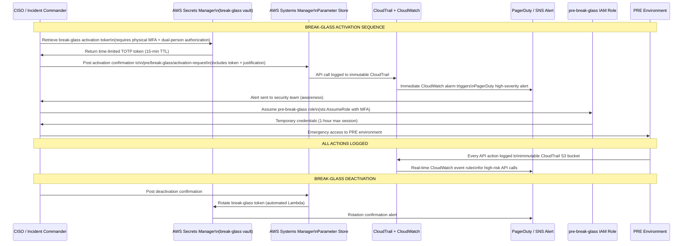

### Break-Glass Components

**1. Break-Glass Vault (Secrets Manager)**

```
Secret Name:    /pre/break-glass/activation-credentials
Type:           TOTP seed (hardware-backed)
Rotation:       After every use + scheduled 90-day rotation
Access:         Restricted to pre-break-glass-vault-accessor role
                Requires dual-person authorization (two distinct MFA tokens)
Encryption:     alias/pre-secrets KMS key
Versioning:     Enabled (retain 3 previous versions)
```

**2. Break-Glass Activation Lambda**

```
Function Name:  pre-break-glass-activator
Runtime:        Python 3.12
Trigger:        SSM Parameter Store change event (via EventBridge)
Actions:
  1. Validates activation token from Secrets Manager
  2. Verifies dual-person authorization (two distinct IAM principals)
  3. Assumes pre-break-glass-activator role temporarily
  4. Grants sts:AssumeRole on pre-break-glass to requestor's IAM principal
  5. Sets 1-hour credential TTL
  6. Sends immediate notification to security team (SNS → PagerDuty)
  7. Logs all steps to immutable CloudTrail
Environment Variables:
  BREAK_GLASS_ROLE_ARN: arn:aws:iam::<PRE_ACCOUNT_ID>:role/pre-break-glass
  ALERT_SNS_TOPIC_ARN:  arn:aws:sns:eu-central-1:<PRE_ACCOUNT_ID>:pre-break-glass-alerts
  MAX_SESSION_DURATION: 3600
```

**3. Break-Glass Monitoring (CloudWatch)**

```
Alarm: pre-break-glass-role-assumed
  Metric:   CloudTrailEventCount
  Filter:   { $.eventName = "AssumeRole" && $.requestParameters.roleArn = "*pre-break-glass*" }
  Threshold: >= 1 within 1 minute
  Action:   SNS → PagerDuty P1 alert + Email to CISO + Security team

Alarm: pre-break-glass-console-login
  Metric:   CloudTrailEventCount
  Filter:   { $.eventSource = "signin.amazonaws.com" && $.userIdentity.sessionContext.sessionIssuer.arn = "*pre-break-glass*" }
  Threshold: >= 1 within 1 minute
  Action:   SNS → PagerDuty P1 alert

EventBridge Rule: pre-break-glass-high-risk-actions
  Event Pattern:
    source: aws.iam, aws.kms, aws.ec2
    detail.userIdentity.sessionContext.sessionIssuer.arn: "*pre-break-glass*"
    detail.eventName: [DeleteRole, DisableKey, TerminateInstances, ...]
  Target: Lambda (security-incident-auto-responder)
```

**4. Break-Glass Procedure Runbook (Steps)**

```
PRE-REQUISITES:
  - Physical MFA device registered for break-glass use
  - Dual-person authorization: two authorized approvers must co-sign
  - Contact CISO and Security Operations before initiating

STEP 1: Declare break-glass event
  - Log incident in security ticketing system (reference number required)
  - Notify CISO and DR Team Lead
  - Record justification: incident ID, reason, expected duration

STEP 2: Retrieve activation token (requires 2 approvers)
  - Approver 1: Authenticates to Secrets Manager with their MFA
  - Approver 2: Authenticates and co-signs the retrieval request
  - Retrieve TOTP token from /pre/break-glass/activation-credentials
  - Token is valid for 15 minutes only

STEP 3: Submit activation request
  - POST to SSM Parameter /pre/break-glass/activation-request:
    {
      "incident_id": "<TICKET-ID>",
      "requestor_arn": "<IAM ARN>",
      "approver_1_arn": "<IAM ARN>",
      "approver_2_arn": "<IAM ARN>",
      "justification": "<free text>",
      "totp_token": "<15-digit token>"
    }
  - Lambda validates and grants temporary assume-role permission

STEP 4: Assume break-glass role
  aws sts assume-role \
    --role-arn arn:aws:iam::<PRE_ACCOUNT_ID>:role/pre-break-glass \
    --role-session-name "break-glass-<TICKET-ID>" \
    --serial-number <MFA_SERIAL> \
    --token-code <MFA_CODE> \
    --duration-seconds 3600

STEP 5: Perform required operations
  - ALL actions are logged to immutable CloudTrail
  - Security team receives real-time alerts
  - Session expires automatically after 1 hour
  - Re-assumption requires new activation request

STEP 6: Deactivation
  - POST deactivation to /pre/break-glass/deactivation-request
  - Lambda rotates break-glass token automatically
  - Document all actions taken in incident ticket
  - Security team reviews CloudTrail logs within 24 hours
```

---

## ISO Environment Connectivity — DR VPC to Shared Services

### Connectivity Architecture

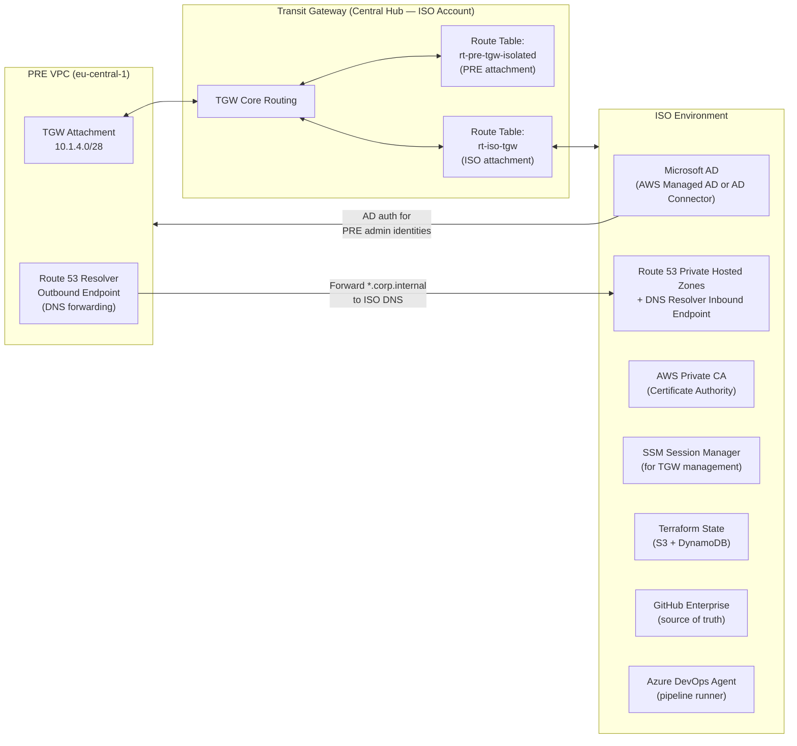

### DNS Configuration

**Route 53 Resolver — Outbound Endpoint (PRE VPC)**

```
Resource:        aws_route53_resolver_endpoint
Direction:       OUTBOUND
Name:            pre-resolver-outbound
IP Addresses:
  - Subnet: pre-mgmt-a  IP: 10.1.0.10
  - Subnet: pre-mgmt-b  IP: 10.1.0.138

Forwarding Rules:
  Domain: corp.internal        → ISO DNS Inbound Endpoint (10.2.x.x)
  Domain: internal.aws         → ISO DNS Inbound Endpoint (10.2.x.x)
  Domain: amazonaws.com        → (default Route 53 resolver)
  Domain: .                    → (default Route 53 resolver)
```

**Route 53 Private Hosted Zone (PRE)**

```
Zone Name:        pre.corp.internal
VPC Association:  vpc-pre-eu-central-1 (auto-associated)

Records:
  mgmt.pre.corp.internal       → 10.1.0.0/25 (management subnet)
  workload.pre.corp.internal   → 10.1.1.0/24 (workload subnet)
  scan.pre.corp.internal       → 10.1.2.0/24 (scan subnet)
  kms.pre.corp.internal        → VPC endpoint (kms)
  ssm.pre.corp.internal        → VPC endpoint (ssm)
```

### Microsoft AD Integration for PRE

```
AD Domain:          corp.internal (hosted in ISO environment)
PRE Organizational Unit:
  OU=PRE,OU=CyberRecovery,DC=corp,DC=internal

Dedicated AD Groups:
  CN=dr-pre-admins,OU=PRE         → Maps to: pre-dr-admin IAM role
  CN=dr-pre-network,OU=PRE        → Maps to: pre-dr-network-admin IAM role
  CN=dr-pre-kms,OU=PRE            → Maps to: pre-dr-kms-admin IAM role
  CN=dr-pre-readonly,OU=PRE       → Maps to: pre-dr-readonly IAM role
  CN=dr-break-glass,OU=PRE        → Maps to: pre-break-glass activation

AD Connectivity:
  Protocol: LDAPS (port 636) — TLS only, no plain LDAP
  Path:     PRE VPC → TGW → ISO VPC → ISO MSAD
  
AWS IAM Identity Center (SSO) SAML integration:
  IdP:      Microsoft AD via ADFS (hosted in ISO)
  SP:       AWS IAM Identity Center
  MFA:      Required for all PRE role assignments (enforced by SAML assertion)
```

### Certificate Management

```
Certificate Authority:  AWS Private CA (hosted in ISO environment)
CA ARN:                 arn:aws:acm-pca:eu-west-1:<ISO_ACCOUNT_ID>:certificate-authority/<id>

PRE Certificate Issuance:
  - PRE instances request certs via ACM Private CA endpoint (via TGW)
  - CRL distribution point accessible from PRE VPC (via private S3 endpoint)
  - Certificate templates for:
    - Internal HTTPS endpoints
    - Workload mutual TLS
    - Security tool agent authentication

PKI Path:
  PRE workload → ACM Private CA API (via TGW) → ISO Private CA
              → Certificate issued → PRE Secrets Manager (stored encrypted)
```

---

## Security Tool Integration (Tanium, CrowdStrike, Qualys)

### Integration Architecture

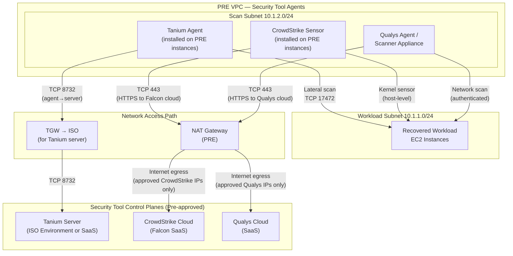

### Tanium Integration

```
Deployment Model:   Agent-based (installed on all PRE EC2 instances at launch via EC2 user-data)
Server Location:    ISO Environment (existing Tanium server, pre-approved access)
Agent Version:      Pinned to ISO-approved version (via SSM Parameter Store)
Communication:      TCP 8732 (PRE → ISO via TGW)

IAM Role for Tanium (pre-scan-tool-access):
  Permissions:
    - ssm:GetParameter (read Tanium registration token from Parameter Store)
    - s3:PutObject (upload scan results to pre-scan-results-bucket)
    - logs:PutLogEvents (write Tanium telemetry to CloudWatch)

Security Group for Tanium:
  sg-pre-scan-tools inbound: TCP 17472 from sg-pre-workload (agent-to-agent)
  sg-pre-scan-tools outbound: TCP 8732 to 10.2.0.0/16 (ISO Tanium server)

Tanium Modules Active in PRE:
  - Tanium Protect (host firewall + application control)
  - Tanium Detect (threat detection + EDR)
  - Tanium Comply (compliance scanning)
  - Tanium Discover (asset inventory)

User-data script (EC2 launch):
  #!/bin/bash
  TANIUM_TOKEN=$(aws ssm get-parameter --name /pre/tanium/registration-token \
                 --with-decryption --region eu-central-1 \
                 --query Parameter.Value --output text)
  TANIUM_SERVER=$(aws ssm get-parameter --name /pre/tanium/server-address \
                  --region eu-central-1 --query Parameter.Value --output text)
  curl -O https://pre-artifacts-bucket.s3.eu-central-1.amazonaws.com/tanium/TaniumClient.rpm
  rpm -ivh TaniumClient.rpm
  /opt/Tanium/TaniumClient/TaniumClient config set ServerNameList $TANIUM_SERVER
  /opt/Tanium/TaniumClient/TaniumClient config set LogVerbosityLevel 1
  systemctl start TaniumClient && systemctl enable TaniumClient
```

### CrowdStrike Integration

```
Deployment Model:   Kernel-level sensor (installed on all PRE instances)
Console:            Falcon SaaS (crowdstrike.com)
Communication:      HTTPS (TCP 443) to Falcon cloud via NAT Gateway

Falcon CID:         <PRE-specific CID or shared CID with PRE tag>
Sensor Tags:        "PRE", "cyber-recovery", "eu-central-1"
Prevention Policy:  PRE-Hardened (strict prevention mode during recovery)

Egress Allow (NAT Gateway SG):
  Outbound TCP 443 to CrowdStrike IP ranges:
    35.191.0.0/16    (Falcon US-1)
    162.254.0.0/16   (Falcon cloud)
    Use CrowdStrike's published IP list for exact ranges

IAM for CS (pre-scan-tool-access supplementary):
  - s3:PutObject → pre-scan-results-* (upload detection logs)
  - cloudwatch:PutMetricData (operational metrics)

Installation via SSM Run Command (triggered at PRE activation):
  aws ssm send-command \
    --instance-ids $(get_all_pre_instances) \
    --document-name "AWS-RunShellScript" \
    --parameters commands=["
      CS_CID=$(aws ssm get-parameter --name /pre/crowdstrike/cid --with-decryption --output text --query Parameter.Value)
      curl -O https://pre-artifacts-bucket.s3.eu-central-1.amazonaws.com/crowdstrike/falcon-sensor.rpm
      rpm -ivh falcon-sensor.rpm
      /opt/CrowdStrike/falconctl -s --cid=$CS_CID --tags='PRE,cyber-recovery'
      systemctl start falcon-sensor
    "]
```

### Qualys Integration

```
Deployment Model:   Cloud Agent + Virtual Scanner Appliance in PRE scan subnet
Console:            Qualys Cloud Platform (SaaS)
Communication:      HTTPS (TCP 443) to Qualys cloud via NAT Gateway

Scanner Appliance:
  Instance:         t3.medium in pre-scan-a subnet
  SG:               sg-pre-scan-tools
  IAM:              pre-scan-tool-access role
  Scan Scope:       10.1.1.0/24 (workload subnet) — authenticated scans

Cloud Agent:
  Installed on:     All PRE workload EC2 instances
  Communication:    TCP 443 outbound to Qualys cloud (via NAT)

Scan Profiles:
  - Initial restore scan: Full vulnerability scan + malware detection (immediate on workload arrival)
  - Continuous scan:      Weekly scheduled scan during PRE staging
  - Pre-promotion scan:   Full scan 24 hours before promotion gate

Qualys Activation Key: Stored in Secrets Manager (/pre/qualys/activation-key)
                        Encrypted with alias/pre-secrets
```

---

## Workload Promotion Workflow: IRE → PRE → Production

### Promotion State Machine

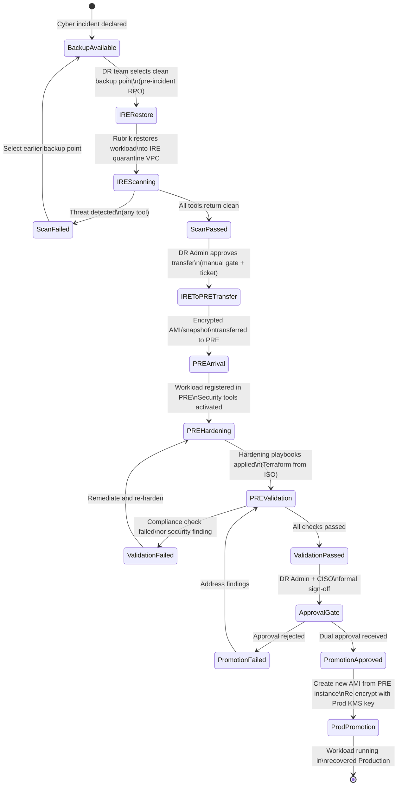

### IRE → PRE Transfer Mechanism

```
Transfer Method:   AWS Backup cross-account copy + AMI re-encryption
                   (NOT direct network connection — prevents lateral movement)

Step-by-step:
  1. In IRE Account:
     a. Create final AMI of cleansed workload instance
     b. Encrypt AMI snapshot with IRE KMS key (alias/ire-workload)
     c. Share AMI with PRE account ID (modify-image-attribute)
     
  2. Cross-account snapshot share:
     aws ec2 modify-snapshot-attribute \
       --snapshot-id snap-<IRE_SNAPSHOT_ID> \
       --attribute createVolumePermission \
       --operation-type add \
       --user-ids <PRE_ACCOUNT_ID>

  3. In PRE Account:
     a. Copy AMI from IRE account with re-encryption
     aws ec2 copy-image \
       --source-region eu-central-1 \
       --source-image-id ami-<IRE_AMI_ID> \
       --name "pre-restored-<WORKLOAD>-<DATE>" \
       --encrypted \
       --kms-key-id alias/pre-workload \
       --region eu-central-1
     
     b. Verify AMI integrity (checksum validation Lambda)
     c. Register AMI in PRE SSM inventory
     d. Remove cross-account share from IRE side

  4. Launch in PRE workload subnet:
     aws ec2 run-instances \
       --image-id ami-<PRE_COPIED_AMI_ID> \
       --instance-type <WORKLOAD_TYPE> \
       --subnet-id subnet-pre-workload-a \
       --security-group-ids sg-pre-workload \
       --iam-instance-profile pre-workload-instance \
       --ebs-optimized \
       --block-device-mappings '[{
         "DeviceName": "/dev/xvda",
         "Ebs": {"VolumeType": "gp3", "Encrypted": true, "KmsKeyId": "alias/pre-ebs"}
       }]' \
       --tag-specifications 'ResourceType=instance,Tags=[
         {Key=Environment,Value=PRE},
         {Key=Workload,Value=<NAME>},
         {Key=IncidentID,Value=<TICKET>},
         {Key=RestoredFrom,Value=<IRE_AMI_ID>},
         {Key=RestoreDate,Value=<DATE>}
       ]'
```

### PRE Hardening Playbooks (Terraform)

```
Terraform Source:   GitHub (ISO) → Azure DevOps Pipeline → deploys to PRE
State Backend:      S3 (ISO account) + DynamoDB lock
                    State files NOT stored in PRE account

Hardening Modules Applied (order-dependent):
  1. module/pre-os-baseline
     - Disable unused services, ports
     - Enable auditd, enforce SELinux/AppArmor
     - Apply CIS benchmark Level 2

  2. module/pre-patch-management
     - Apply all OS security patches (via SSM Patch Manager)
     - Reboot if kernel updates applied
     - Verify patch compliance score ≥ 95%

  3. module/pre-iam-instance-hardening
     - Remove any IAM credentials found on disk
     - Verify instance profile = pre-workload-instance only
     - Disable instance metadata v1 (IMDSv2 only)
     
     aws ec2 modify-instance-metadata-options \
       --instance-id <INSTANCE_ID> \
       --http-tokens required \
       --http-endpoint enabled \
       --http-put-response-hop-limit 1

  4. module/pre-network-hardening
     - Apply host firewall rules (iptables/nftables)
     - Disable IPv6 (unless required)
     - Verify security group compliance

  5. module/pre-security-tool-verification
     - Confirm Tanium agent running and registered
     - Confirm CrowdStrike sensor running (kernel module loaded)
     - Confirm Qualys agent registered and reporting

  6. module/pre-compliance-scan
     - Run AWS Config rules evaluation
     - Run Qualys compliance scan
     - Fail pipeline if critical findings remain
```

### Promotion Gate Checklist

```
AUTOMATED CHECKS (must all pass before manual review):
  [ ] All Tanium Comply checks passed (CIS Level 2 ≥ 95%)
  [ ] CrowdStrike: No active detections on instance
  [ ] Qualys: No Critical or High CVEs unpatched
  [ ] AWS Config: 0 non-compliant rules
  [ ] VPC Flow Logs: No anomalous outbound connections during PRE staging
  [ ] SSM Patch Manager: Compliance = "Compliant"
  [ ] IMDSv2: Enforced (hop limit = 1)
  [ ] EBS encryption: Verified (alias/pre-ebs)
  [ ] Security groups: Matches approved baseline (automated diff)
  [ ] No leftover credentials/keys on disk (Tanium Discover check)

MANUAL APPROVAL GATE (dual sign-off required):
  [ ] DR Team Lead sign-off (documents all automated check results)
  [ ] CISO or delegate sign-off (reviews security tool findings)
  [ ] Incident ticket updated with promotion rationale
  [ ] Rollback plan documented

PROMOTION STEPS (post-approval):
  1. Create final AMI from PRE instance
  2. Re-encrypt snapshot with new Prod KMS key (new key, not reused)
  3. Share AMI with Production account
  4. Deploy to Production via Terraform pipeline (ISO → Prod)
  5. Decommission PRE instances after Prod validation
  6. Rotate all PRE credentials and keys post-recovery
  7. Archive PRE CloudTrail logs to Glacier (7-year retention)
```

---

## Logging, Monitoring, and Compliance

### Audit Trail Configuration

```
CloudTrail:
  Trail Name:       pre-audit-trail
  S3 Bucket:        pre-cloudtrail-logs-<ACCOUNT_ID>
  Region:           eu-central-1 (+ global service events)
  Multi-region:     false (PRE-specific)
  Log file validation: Enabled (SHA-256 digest files)
  KMS Encryption:   alias/pre-cloudtrail
  S3 Object Lock:   COMPLIANCE mode, 7 years
  SNS Topic:        pre-cloudtrail-alerts (for real-time processing)

CloudWatch Log Groups:
  /pre/vpc-flow-logs          Retention: 90 days → S3 archive 7 years
  /pre/ssm-session-manager    Retention: 365 days (all session activity)
  /pre/security-tools         Retention: 365 days (Tanium/CS/Qualys)
  /pre/break-glass            Retention: 7 years (compliance)
  /pre/workload-os-logs       Retention: 90 days

AWS Config:
  Recorder:         All resource types in eu-central-1
  Delivery Channel: S3 (pre-config-logs bucket, Object Lock enabled)
  Rules:
    - encrypted-volumes (all EBS must use alias/pre-ebs)
    - restricted-ssh (SG must not have 0.0.0.0/0 for port 22)
    - restricted-common-ports (block well-known ports from internet)
    - iam-no-inline-policies (enforce managed policies)
    - root-account-mfa-enabled
    - s3-bucket-server-side-encryption-enabled
    - vpc-flow-logs-enabled
    - cloud-trail-encryption-enabled
    - iam-password-policy (enforce strong password policy)
```

---

## Summary of Architecture Decisions

| Decision | Choice | Rationale |
|----------|--------|-----------|
| PRE base | Existing DR VPC (`eu-central-1`) | Reduces provisioning time; existing infrastructure with known topology |
| Admin identity | Dedicated AD OU in ISO, separate from Prod | No credential overlap; attack on Prod cannot compromise PRE admin identities |
| KMS keys | Independent PRE key ring, `pre-dr-kms-admin` role separate from general admin | Separation of duties; compromised admin cannot delete/disable encryption keys |
| Prod→PRE network | TGW route blackholed + NACL explicit deny | Defense in depth; TGW blackhole is software-enforced, NACL adds second layer |
| IRE→PRE transfer | Cross-account AMI copy with re-encryption (no network path) | Prevents any malware from using network to propagate; artifact-only transfer |
| Break-glass | SSM + Lambda + dual-person Secrets Manager token | Out-of-band; does not rely on AD/SAML which may be compromised; dual approval prevents insider threat |
| Security tools | Tanium + CrowdStrike + Qualys (pre-approved, same as IRE) | Consistent tooling across IRE and PRE; no new tool deployment delays; pre-approved access patterns |
| ISO connectivity | TGW with isolated route table (no Prod routes) | Re-uses existing TGW fabric; strict route table prevents Prod-to-PRE transit |
| Terraform state | ISO account S3/DynamoDB | PRE cannot modify its own IaC; state lives outside PRE trust boundary |
